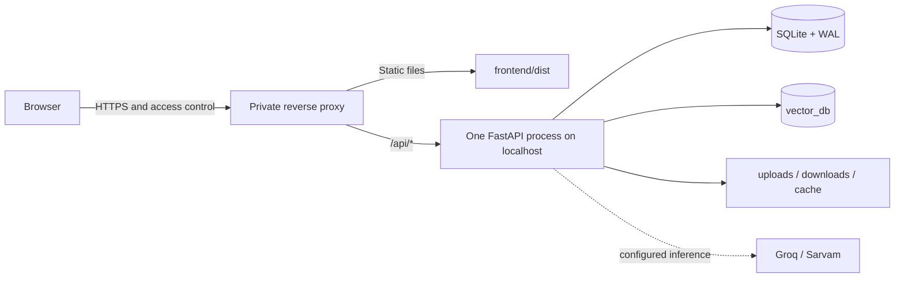

# FrameSutra deployment guide

FrameSutra currently ships as a local development application: a React/Vite client and a Python FastAPI backend. The repository does not include a supported Dockerfile, production web server configuration, authentication service, or public deployment pipeline. Use the local setup for personal use. A network-facing deployment requires additional security and operations work described below.

- [Local development setup](#local-development-deployment)
- [Private-host architecture](#private-host-architecture)
- [Production readiness requirements](#before-a-network-facing-deployment)
- [Operations and storage](#storage-backup-and-cleanup)
- [Privacy review](docs/PRIVACY_AND_TERMS.md)

## Local development deployment

Install Python, Node/npm, FFmpeg, and ffprobe. Configure provider keys in root `.env` from `.env.example`.

```powershell
# Project root: create and install Python environment once
py -3.12 -m venv .venv
.\.venv\Scripts\python.exe -m pip install -r Requirements.txt
Copy-Item .env.example .env

# Terminal 1: local API
.\.venv\Scripts\python.exe -m uvicorn api:app --host 127.0.0.1 --port 8000 --reload

# Terminal 2: web interface
cd frontend
npm install
npm run dev
```

Edit `.env` before launching. `GROQ_API_KEY` is required for analysis; add `SARVAM_API_KEY` for Hinglish. Open Vite’s printed local URL. Visit `http://127.0.0.1:8000/docs` for the live API schema.

The legacy Streamlit UI may be run separately with `streamlit run app.py` after the same Python and provider setup. `run.bat` is a convenience launcher that expects a `.venv` directory.

## Private-host architecture

For a trusted private host, build the frontend with `npm run build`, serve `frontend/dist/` as static files, and configure a reverse proxy so that:

1. The browser receives the frontend from the proxy/static server.
2. Requests under `/api/` are proxied to one FastAPI process bound to `127.0.0.1:8000`.
3. Upload request size and timeout limits accommodate the configured media sizes and long-running analysis polling.
4. The static frontend and API share an origin, or `FRONTEND_ORIGINS` is explicitly configured for the frontend origin.
5. TLS and access controls are provided by the host network layer.

The client currently uses same-origin `/api` paths; Vite supplies a development proxy. The API does not serve the built React app by itself. `npm run preview` is a preview server, not an Internet-facing production server.



This is an architecture outline, not a ready-made production deployment. Choose a process manager, reverse proxy, TLS configuration, static-file server, backup schedule, and log policy appropriate to the host. The repository does not currently include a validated Nginx/Caddy/Docker configuration.

## Before a network-facing deployment

The current API uses client IP-derived ownership and rate-limit keys. This is not user authentication or safe tenant isolation. Before exposing the app beyond a trusted local network, add and validate:

- Authentication and per-user authorization for every job, audio, export, chat, bookmark, study, and deletion route.
- HTTPS, secure session management, CSRF protections where applicable, and trusted proxy configuration.
- Upload quotas, abuse controls, API-level timeouts, and resource isolation.
- A durable supervised job queue if jobs must survive process loss or support multiple workers.
- Persistent storage, backup/restore drills, monitoring, and incident response.
- A published owner/support contact, license, and reviewed jurisdiction-appropriate terms and privacy notice.
- Provider-data review for the specific accounts and models in use.

Do not run multiple Uvicorn workers with the present in-process queue: each process creates its own worker executor and in-memory RAG cache. The SQLite job state is shared, but work admission and cached chains are not a distributed queue design.

## Configuration and capacity

See [configuration reference](docs/OPERATIONS.md#configuration-reference). Key defaults include 1 worker, 3 outstanding jobs, 512 MB upload size, 6 hours of media, 3 inputs per batch, 5 job submissions/hour, 15 chat/study calls/minute, 30-day unsaved-job retention, and 7-day media retention. Provider limits and system capacity may require smaller values.

## First-run dependencies

- FFmpeg and ffprobe must be available to the backend process.
- Whisper and sentence-transformer weights may download at first use; plan for storage and startup/processing delay.
- Groq and Sarvam are external services; API keys, account limits, endpoint/model availability, and network connectivity apply.
- YouTube/`yt-dlp` support can change; public URLs are not guaranteed to be downloadable.

## Storage, backup, and cleanup

Data may appear in `videolens.sqlite3` (the legacy-compatible database filename, plus WAL/SHM files), `vector_db/`, `uploads/`, `downloads/`, and `.cache/`. These can contain media, transcripts, embeddings, and conversation data. Keep all of them out of public source control and restrict filesystem access.

Stop the API before copying SQLite/WAL and Chroma data. Back up the database and matching vector/media data together when you need a restorable analysis library. Automatic defaults are 30 days for unsaved records and 7 days for media; saved jobs persist until deleted. A cache clear does not delete saved results. Full reset steps are in [Operations](docs/OPERATIONS.md#backup-and-full-reset).

## Deployment checklist

- [ ] Secrets are stored outside source control and rotated if exposed.
- [ ] API is private or authenticated; there is no built-in login.
- [ ] API and static frontend are correctly routed under the selected origin.
- [ ] Upload size/timeouts align with actual `.env` limits and disk capacity.
- [ ] FFmpeg, model downloads, provider access, and provider billing/limits are understood.
- [ ] Retention cleanup, full deletion, backups, and restore have been reviewed.
- [ ] Short English, Hinglish (if used), local visual analysis, export, cancellation, and retry paths have been exercised with non-sensitive sample media.
- [ ] User-facing privacy/terms and project ownership details have been reviewed before sharing.
