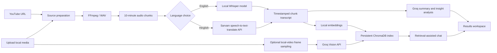
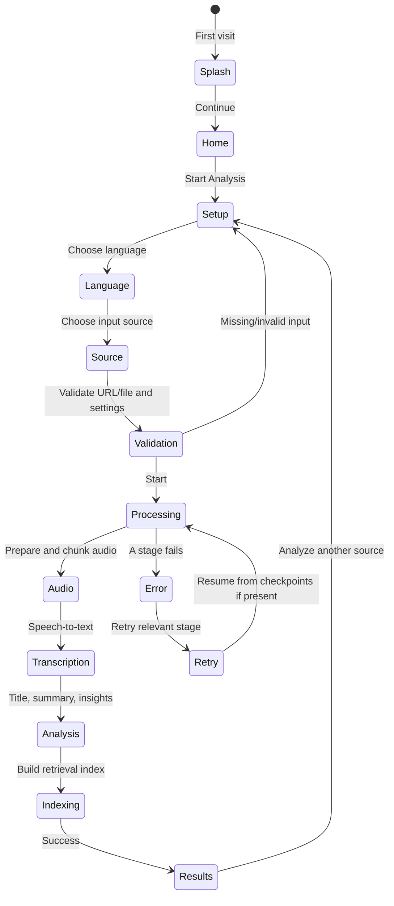
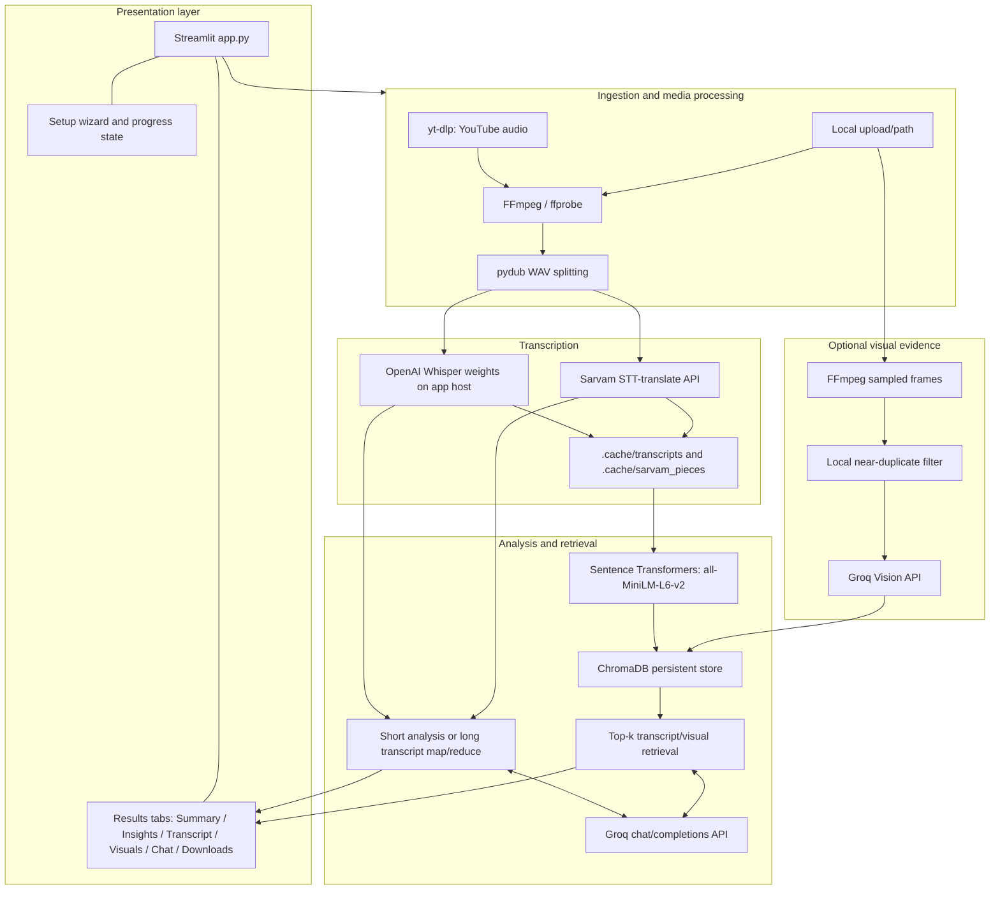
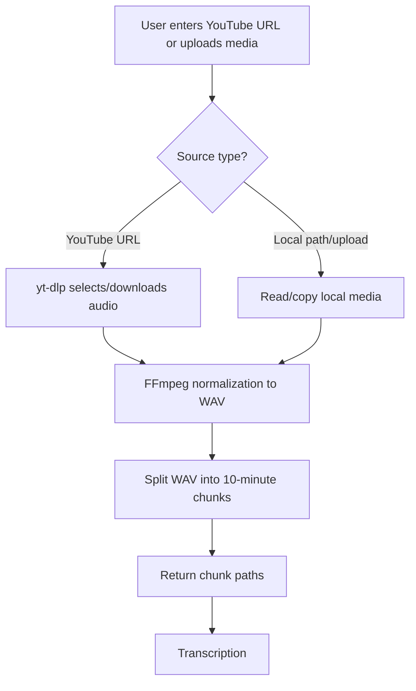
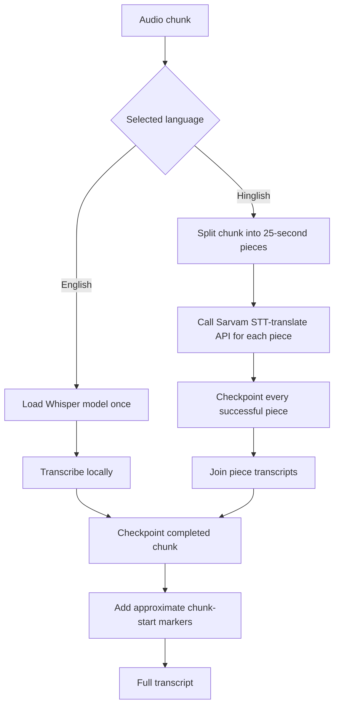
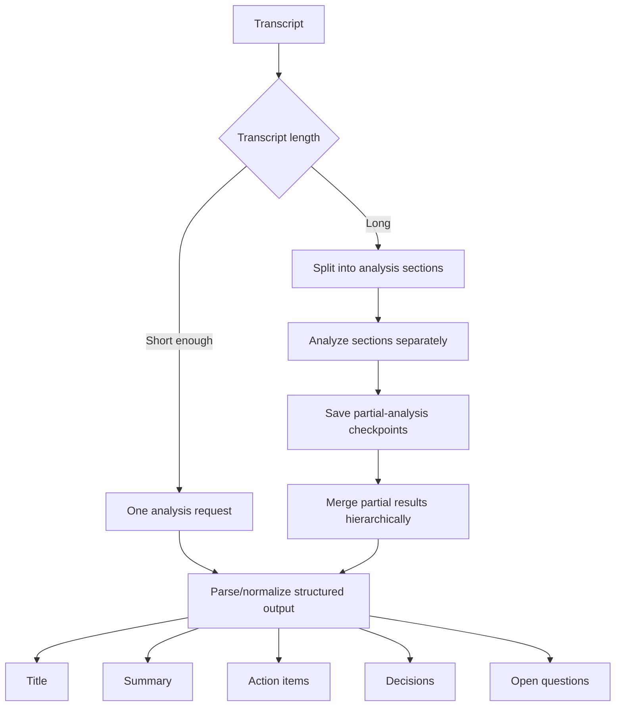
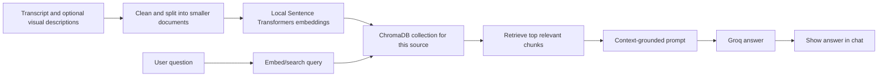
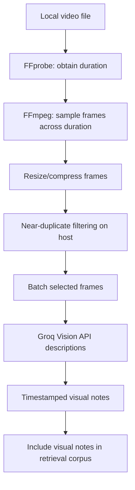
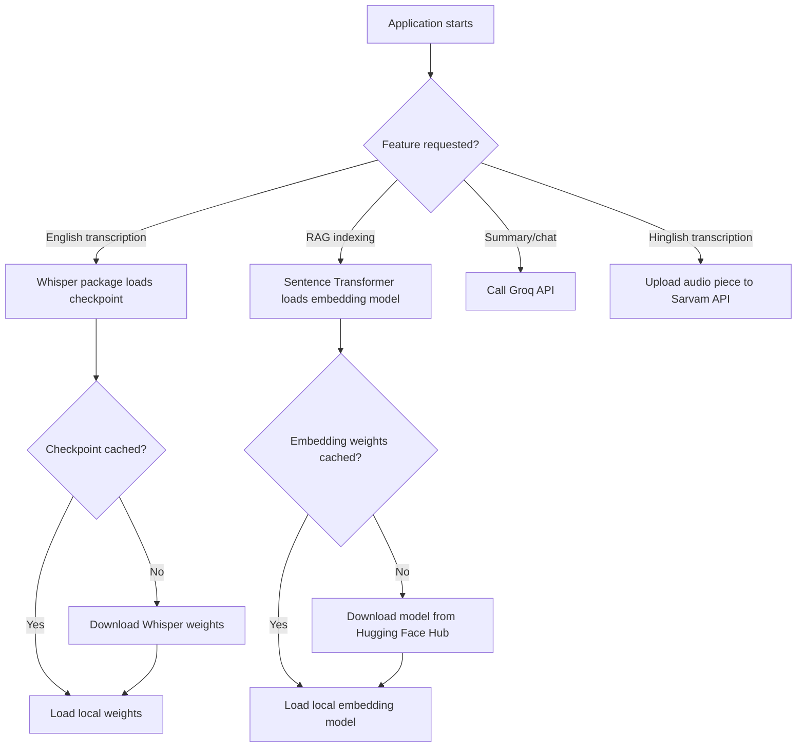
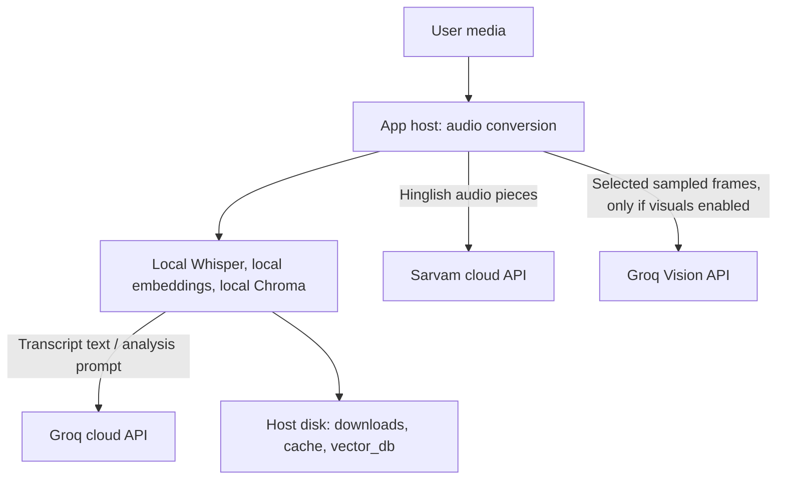

# 🎬 VideoLens — AI Video Analyzer & Transcript RAG Assistant

<p align="center">
  <strong>Turn long videos into searchable knowledge.</strong><br/>
  Analyze YouTube links or local audio/video, generate structured notes, inspect sampled visuals, and ask questions grounded in the transcript.
</p>

<p align="center">
  
  
  
  
  
  
</p>

> **Project status:** Local-first Streamlit application / prototype. English transcription and embeddings run on the app host; Groq and Sarvam are cloud APIs. This is not a fully offline system. See [Privacy, Security & Data Flow](#-privacy-security--data-flow) before using private recordings.

---

## 📚 Table of contents

- [What is VideoLens?](#-what-is-videolens)
- [At a glance](#-at-a-glance)
- [Feature matrix](#-feature-matrix)
- [Application journey](#-application-journey)
- [System architecture](#-system-architecture)
- [Processing pipeline](#-processing-pipeline)
- [Language and model routing](#-language-and-model-routing)
- [RAG: how chat answers questions](#-rag-how-chat-answers-questions)
- [Visual frame analysis](#-visual-frame-analysis)
- [Long videos and checkpointing](#-long-videos-and-checkpointing)
- [Charts and analytics](#-charts-and-analytics)
- [Technology stack](#-technology-stack)
- [Project structure](#-project-structure)
- [Requirements](#-requirements)
- [Run locally on Windows](#-run-locally-on-windows)
- [Environment variables](#-environment-variables)
- [First-run model downloads](#-first-run-model-downloads)
- [Deploy with the model](#-deploy-with-the-model)
  - [Deployment choice](#deployment-choice)
  - [Option A — Hugging Face Docker Space](#option-a--hugging-face-docker-space)
  - [Option B — Docker VPS / cloud VM](#option-b--docker-vps--cloud-vm)
  - [Why Community Cloud may not fit the full pipeline](#why-community-cloud-may-not-fit-the-full-pipeline)
- [Validation checklist](#-validation-checklist)
- [Troubleshooting](#-troubleshooting)
- [Known limitations](#-known-limitations)
- [Privacy, security & data flow](#-privacy-security--data-flow)
- [Roadmap](#-roadmap)
- [Useful links](#-useful-links)

---

## 🧠 What is VideoLens?

VideoLens is an AI-assisted video understanding workspace. Give it a public YouTube URL or upload a local media file. The application prepares the audio, transcribes speech, produces structured analysis, optionally samples video frames, indexes the evidence, and provides a chat interface for questions about the active video.

It is intended for lectures, tutorials, recorded meetings, technical explanations, presentations, and other long-form content. The generated notes are intended to help you review content faster; they are not a substitute for checking the original video when exact wording, legal meaning, or high-stakes decisions matter.

### Core outputs

| Output | What it contains |
|---|---|
| **Title and summary** | A generated title and readable summary of the transcript. |
| **Actions and decisions** | Extracted next steps, decisions, and open questions when these appear in the available transcript. |
| **Transcript** | Speech text with approximate ten-minute chunk markers. These are not word-level timestamps. |
| **Audio chunks** | Processed WAV chunks when their generated files are still available. |
| **Visual timeline** | Optional descriptions for sampled frames from a local video. |
| **AI chat** | Retrieval-assisted answers based on transcript chunks and available visual descriptions. |
| **Downloads** | Transcript, analysis/report data and other exports exposed by the current UI. |

---

## ✨ At a glance



**In plain English:** audio preparation and English transcription happen on the machine/container running VideoLens; Hinglish transcription is sent to Sarvam; summaries and chat are sent to Groq; transcript embeddings and Chroma retrieval are local to the app host.

---

## ✅ Feature matrix

| Capability | Status | Notes |
|---|---|---|
| YouTube link input | Available, subject to YouTube/yt-dlp availability | YouTube may change its player challenges. A working URL does not guarantee every client/format is downloadable. |
| Local audio/video upload | Available | Input files are processed on the host running the app. |
| English transcription | Available | OpenAI Whisper package, local CPU by default. Model weights are downloaded on first use. |
| Hinglish transcription/translation | Available | Sarvam API; audio is sent to the provider in short pieces. Output is translated to English by the configured endpoint. |
| Title, summary, action items and decisions | Available | Groq-hosted language model; requires a valid model ID and API key. |
| Long transcript analysis | Checkpointed map/reduce path in core analyzer | Reduces the need to resend the full transcript as one prompt; API limits still apply. |
| Transcript RAG chat | Available | Sentence Transformers embeddings + persistent ChromaDB + Groq answers. |
| Sampled visual analysis | Optional | Local video files only; selected frames are sent to Groq Vision. |
| 12-hour media | Best-effort/resumable, not a guaranteed SLA | Can take a long time and may hit API limits, host timeouts, disk limits or interruptions. |
| Speaker diarization | Not implemented as a full pipeline | Sarvam request currently disables diarization. |
| Word-level timestamps | Not implemented | Current transcript marks the start of each ten-minute audio chunk approximately. |
| Background job queue / multi-worker deployment | Not implemented | Long work runs in the Streamlit app process. Avoid expecting production-grade multi-user concurrency. |

---

## 🧭 Application journey

The refreshed UI separates configuration, work-in-progress and results. The exact labels may vary slightly by UI version, but the processing stages stay the same.



### User steps

1. **Start Analysis** — open the setup wizard.
2. **Choose speech language** — English uses local Whisper; Hinglish uses Sarvam.
3. **Choose a source** — paste a YouTube link *or* upload a local video/audio file. A local video is required for the current visual-analysis path.
4. **Review progress** — active pipeline stages should be highlighted as the app processes the media.
5. **Explore results** — read the summary, review actions/decisions, listen to available audio chunks, inspect visuals, ask grounded questions, and download the supported exports.

---

## 🏗️ System architecture



### Processing responsibilities

| Layer | Primary responsibility | Key implementation area |
|---|---|---|
| UI and session state | Navigation, form inputs, progress state, results and downloads | `app.py` |
| Configuration | Load `.env` from the project root and resolve paths | `core/config.py` |
| Media preparation | Download/convert media and split WAV audio | `utils/audio_processor.py` |
| Speech transcription | Whisper or Sarvam routing, checkpointing, transcript assembly | `core/transcriber.py` |
| Analysis | Title, summary, action items, decisions, questions; long-text analysis path | `core/analyzer.py` |
| LLM provider | Configure Groq model and retry eligible rate-limit failures | `core/llm_provider.py` |
| Vector store | Local embeddings, transcript-specific collection and persistence | `core/vector_store.py` |
| RAG chat | Retrieve relevant evidence and formulate an answer | `core/rag_engine.py` |
| Optional vision | Sample frames, remove near duplicates and ask Groq Vision for descriptions | `core/visual_analyzer.py` |
| Setup check | Verify `.env`, API key presence and FFmpeg executables | `check_setup.py` |

> **Repository note:** keep the importable directory layout intact. The main app imports modules from `core/` and `utils/`; do not flatten those files into the root folder.

---

## ⚙️ Processing pipeline

### 1. Source acquisition and audio preparation



Why chunk audio? It limits the size of each transcription operation, gives the pipeline useful restart points, and keeps the individual steps manageable. Chunks are approximately ten minutes; Hinglish chunks are subdivided again into 25-second pieces for the synchronous Sarvam endpoint used by the code.

**YouTube note:** yt-dlp can fail when YouTube changes its player/signature challenges, when a video is restricted, or when audio formats are not available to the selected client. The project installs yt-dlp's default extras for EJS support; a supported JavaScript runtime such as Deno 2.3+ or Node.js 22+ may be required for current YouTube challenge solving. See [yt-dlp EJS documentation](https://github.com/yt-dlp/yt-dlp/wiki/EJS).

### 2. Speech-to-text routing



#### English mode

- Runs `openai-whisper` on the host machine/container.
- The selected `WHISPER_MODEL` weights are downloaded when the model is first loaded, unless already cached.
- CPU inference is the default path; long recordings may be slow on CPU. A GPU deployment requires compatible PyTorch/CUDA hardware and a deliberately configured image.

#### Hinglish mode

- Uses Sarvam's `speech-to-text-translate` endpoint.
- Each ten-minute WAV chunk is subdivided into approximately 25-second WAV pieces to fit the synchronous endpoint's audio-duration constraint documented in this code.
- Each completed piece is checkpointed locally; the app can reuse those completed pieces after a retry if the media identity and cache are unchanged.
- Audio pieces are uploaded to Sarvam. Review provider privacy and retention policies before transcribing confidential media.

#### Timestamp precision

The transcript contains markers such as `[Approx. timestamp 00:10:00]` at chunk boundaries. This is **coarse chunk timing**. It is not a word-level transcript, speaker-aligned caption file, or forced alignment result. Use the original audio for exact quotes.

### 3. LLM analysis: summary and insights



The analyzer sends transcript text to the configured **Groq-hosted model**. It does not run the Groq model locally. Long text is analyzed in smaller parts and merged, reducing single-prompt pressure; it does not eliminate provider context, rate, or usage limits.

### 4. Retrieval-Augmented Generation (RAG) chat



**RAG means Retrieval-Augmented Generation.** Rather than asking the language model to answer from general knowledge alone, the app searches the active transcript's local vector index, passes the retrieved text as context, and asks Groq to answer from that context. The retrieval path uses similarity search (top-k, currently configured around four chunks in the project code).

Practical implications:

- Questions about the video are the intended use case.
- If the transcript does not contain a person's name or other detail, a grounded answer can correctly say it could not find the information.
- RAG can still retrieve imperfect matches or the model can misread context. Treat answers as summaries with evidence, not guarantees of factual accuracy.
- Separate transcript collections prevent unrelated videos from being intentionally mixed into the active source's retrieval store.

### 5. Optional visual frame analysis



- The feature is opt-in. The current implementation samples **local video files**, not YouTube video frames.
- The default UI settings can be adjusted for sampling interval and maximum frame count. A maximum of 80 frames is supported by the underlying function; the actual UI default can vary with the current app version.
- Frames are extracted and near-duplicate-filtered locally; selected frames are then sent to Groq Vision for descriptions.
- The model may miss small text, infer incorrectly, or fail on a frame. Review the frame itself for important details.
- If no vision-capable model is available to your Groq account, disable visual analysis or configure a currently supported vision model.

---

## 🧩 Language and model routing

| Task | Model / service | Where the inference runs | Required configuration |
|---|---|---|---|
| English transcription | OpenAI Whisper package (default model name: `small`) | Local machine/container | Optional `WHISPER_MODEL` |
| Hinglish transcription and translation to English | Sarvam STT-translate API (default: `saaras:v2.5`) | Sarvam cloud | `SARVAM_API_KEY`, optional `SARVAM_STT_MODEL` |
| Title, summary, insights and chat responses | Groq Chat API | Groq cloud | `GROQ_API_KEY`, `GROQ_MODEL` |
| Visual frame descriptions | Vision-capable Groq model | Groq cloud | `GROQ_API_KEY`, `GROQ_VISION_MODEL` when enabled |
| Text embeddings | `sentence-transformers/all-MiniLM-L6-v2` | Local machine/container | Model downloads on first use; Hugging Face cache can be persisted |
| Similarity search / vector persistence | ChromaDB | Local machine/container disk | Project's configured `vector_db/` path |
| Video/audio conversion and frame sampling | FFmpeg / ffprobe | Local machine/container | `ffmpeg` and `ffprobe` executables in `PATH` |
| YouTube acquisition | yt-dlp + EJS/runtime as needed | Local machine/container with network access | Current yt-dlp, EJS dependencies and supported JS runtime |

### Recommended `.env` values

Create `.env` beside `app.py` and add your own keys. The example below uses a currently listed Groq production model ID for text generation; always confirm availability and limits in your own Groq account before deployment.

```dotenv
GROQ_API_KEY=put_your_groq_key_here
SARVAM_API_KEY=put_your_sarvam_key_here

# Text generation model — verify this ID in the Groq model catalog.
GROQ_MODEL=openai/gpt-oss-20b

# Local Whisper size: tiny, base, small, medium, large (availability depends on Whisper version)
WHISPER_MODEL=small

# Sarvam speech model for Hinglish route
SARVAM_STT_MODEL=saaras:v2.5

# Optional: configure a vision-capable model accessible to your Groq account.
# GROQ_VISION_MODEL=your_accessible_vision_model_id
```

**Do not copy a retired model ID blindly from an older README or `.env.example`.** The Groq model catalog changes. Find supported IDs in the [official model catalog](https://console.groq.com/docs/models). `GROQ_VISION_MODEL` is only needed when visual frame analysis is enabled and must refer to a model with image/vision input support.

---

## 🛠️ Technology stack

| Technology | Role |
|---|---|
| Python 3.12 | Recommended compatibility baseline for the current dependency set |
| Streamlit | UI, navigation, form widgets, tabs and progress feedback |
| yt-dlp + EJS | YouTube metadata and media acquisition |
| FFmpeg / ffprobe | Audio extraction, conversion, chunk preparation and frame sampling |
| pydub | WAV handling and short-piece slicing for Sarvam |
| OpenAI Whisper | Local English speech transcription |
| Sarvam AI | Hinglish-oriented speech transcription and translation to English |
| Groq API / LangChain Groq | LLM summary, extraction and chat |
| Sentence Transformers | Local embedding generation |
| ChromaDB / LangChain Chroma | Persistent vector store and similarity retrieval |
| python-dotenv | Project-root `.env` loading |

---

## 📁 Project structure

Keep the structure below when copying files or deploying. The actual project can contain additional utility files as it evolves.

```text
VideoLens/
├── app.py                       # Streamlit UI and pipeline orchestration
├── main.py                      # Optional CLI / alternate entry point
├── check_setup.py               # Environment diagnostic script
├── Requirements.txt             # Python dependencies (case-sensitive on Linux)
├── .env.example                 # Safe template; placeholders only
├── .env                         # Real API keys; NEVER commit
├── run.bat                      # Optional Windows launcher
├── core/
│   ├── __init__.py
│   ├── config.py                # Project paths and .env loading
│   ├── transcriber.py           # Whisper/Sarvam routing and checkpoints
│   ├── analyzer.py              # Summary, insights and long-text analysis
│   ├── llm_provider.py          # Groq client/model configuration
│   ├── rag_engine.py            # Retriever and grounded chat
│   ├── vector_store.py          # Embeddings and Chroma persistence
│   ├── visual_analyzer.py       # Local frame sampling + Groq Vision
│   ├── extractor.py             # Extraction helpers, if present in your version
│   └── summarizer.py            # Summary helpers, if present in your version
├── utils/
│   └── audio_processor.py       # yt-dlp, FFmpeg conversion and audio chunks
├── downloads/                   # Downloaded media, uploads and sampled frames
├── .cache/                      # Transcription/analysis/visual checkpoints
└── vector_db/                   # Chroma persistence directory
```

`downloads/`, `.cache/`, `vector_db/`, model weights, uploaded media, `.venv*/`, `__pycache__/` and `.env` should not be added to Git. The exact location of these paths is defined by the version's configuration code; preserve that code when changing the project structure.

---

## 💻 Requirements

### Minimum practical development environment

- Windows 10/11, Linux or macOS.
- Python **3.12 recommended** for this project. In particular, older pydub versions can fail under Python 3.13 because the standard-library `audioop` module was removed. Use Python 3.12 rather than patching files inside `site-packages`.
- FFmpeg and ffprobe installed and discoverable on `PATH`.
- Internet access for first-time model downloads, YouTube downloads, Groq calls and Sarvam calls.
- Groq API key for analysis and chat.
- Sarvam API key only for Hinglish mode.
- A supported JS runtime (Node.js 22+ or Deno 2.3+ recommended by the current yt-dlp EJS guide) for reliable current YouTube challenge solving.
- Enough local disk for source video/audio, WAV conversions/chunks, model caches, vector database and outputs.

> For large videos, model choice matters. Whisper `small` uses less compute than larger Whisper checkpoints. Even with the `small` model, CPU transcription for a long recording may take a substantial amount of time.

---

## 🪟 Run locally on Windows

### 1. Clone or copy the complete project

```powershell
git clone <YOUR_GITHUB_REPOSITORY_URL>
cd <YOUR_PROJECT_FOLDER>
```

If you already have the project on disk, open the project root—the folder containing `app.py`, `Requirements.txt`, `core/` and `utils/`.

### 2. Install Python 3.12 and create a clean environment

Check which Python versions are available:

```powershell
py -0p
py -3.12 --version
```

Create a new environment once:

```powershell
py -3.12 -m venv .venv312
.\.venv312\Scripts\Activate.ps1
python --version
```

The prompt should show `(.venv312)` and Python 3.12.x. Activate this same environment every time you run the application. Do not mix `.venv` created with Python 3.13 and `.venv312` created with Python 3.12.

If PowerShell blocks environment activation for the current user, see [Python's venv documentation](https://docs.python.org/3/library/venv.html) or activate using the terminal instructions for your shell. Avoid editing installed library files to work around an environment mismatch.

### 3. Install Python dependencies

```powershell
python -m pip install --upgrade pip
python -m pip install -r Requirements.txt
python -m pip install --upgrade "yt-dlp[default]"
```

`yt-dlp[default]` includes the companion EJS package on supported PyPI installs. Keep yt-dlp and `yt-dlp-ejs` compatible by upgrading them together. YouTube extraction still depends on the current state of YouTube's service and may require a runtime or authentication for some videos.

### 4. Install FFmpeg and a JavaScript runtime

Install FFmpeg using the official website or a trusted package manager, then verify:

```powershell
ffmpeg -version
ffprobe -version
```

Install a current supported runtime and verify it:

```powershell
node --version
```

Node.js should meet the minimum version stated in the current [yt-dlp EJS setup guide](https://github.com/yt-dlp/yt-dlp/wiki/EJS). Deno is also supported. Restart VS Code after modifying system `PATH` if the terminal cannot find the executable.

### 5. Create `.env`

```powershell
Copy-Item .env.example .env
```

Open `.env` in an editor and add real keys. Do not paste keys into screenshots, chat, README files or Git commits. See [Environment variables](#-environment-variables).

### 6. Run setup diagnostics

```powershell
python check_setup.py
```

This project check reports whether `.env` exists, whether expected API keys appear to be loaded, and whether FFmpeg/ffprobe are discoverable. It is **not** a complete integration test: it does not prove that a provider model ID is available, that every YouTube URL can be downloaded, or that a long-video run will complete.

### 7. Launch Streamlit

```powershell
python -m streamlit run app.py
```

Open the printed local URL, usually `http://localhost:8501`.

### 8. First-run test order

1. Test a short public YouTube URL or a short local audio/video file.
2. Test English mode and verify the terminal says it is using Whisper.
3. Test Hinglish mode only after configuring `SARVAM_API_KEY`.
4. Verify summary generation and RAG chat after the transcript is available.
5. Test optional visuals using a local video file and a Groq vision-capable model.
6. Test long media only after the short path works end to end.

---

## 🔐 Environment variables

| Variable | Required? | Purpose |
|---|---|---|
| `GROQ_API_KEY` | Yes for AI analysis/chat | Authenticates to Groq. |
| `SARVAM_API_KEY` | Hinglish mode only | Authenticates to Sarvam speech-to-text-translate. |
| `GROQ_MODEL` | Optional but recommended to set explicitly | Groq text generation model ID. Confirm it is available to your account. |
| `WHISPER_MODEL` | Optional | Local Whisper checkpoint name; default is `small`. |
| `SARVAM_STT_MODEL` | Optional | Sarvam speech model; current code default is `saaras:v2.5`. |
| `GROQ_VISION_MODEL` | Optional; required when enabling optional frame descriptions | Vision-capable Groq model ID accessible to your account. |

Keep `.env.example` as a template with placeholder values only. For cloud deployment, add the variables through the host's **Secrets/Environment Variables** settings instead of committing `.env`.

---

## 🧠 First-run model downloads

The project uses two kinds of model runtime: local open-source model packages and hosted APIs.



### What is deployed with the app?

- **Whisper:** Python code and package are deployed, then the selected Whisper checkpoint is downloaded to the server cache at first use unless you deliberately bake/cache the weights separately.
- **Sentence Transformer:** the embedding model is downloaded from Hugging Face Hub on first initialization and cached. It is run by the application host.
- **Groq models:** not downloaded into this app. Groq runs text generation remotely; configure `GROQ_API_KEY` and `GROQ_MODEL`.
- **Sarvam:** not downloaded into this app. Speech is sent to Sarvam API; configure `SARVAM_API_KEY` for Hinglish mode.
- **Groq Vision:** remote inference over selected sampled frames. It is optional and requires an accessible vision model.

For hosted deployments, ensure model caches have enough disk space and are stored on a persistent volume if you need them to survive restarts. Without persistence, models may need to be downloaded again after a new container starts.

---

## 🚀 Deploy with the model

### Deployment choice

| Host option | Best use | Important constraint |
|---|---|---|
| **Hugging Face Spaces — Docker** | Shareable hosted demo with Python, FFmpeg and custom runtime dependencies | Default filesystem is ephemeral; use a Storage Bucket/persistent storage if you need to retain caches or job artifacts. CPU transcription can be slow for very long recordings. |
| **Docker on a VPS/cloud VM** | More control, persistent storage and better suitability for longer jobs | You manage OS packages, secrets, security, backups and capacity. A production app needs stronger job isolation/queueing than this prototype currently provides. |
| **Streamlit Community Cloud** | Lightweight proof-of-concept or limited demos | This app uses PyTorch/Whisper, Sentence Transformers, Chroma and FFmpeg. Community Cloud documents relatively tight shared resource limits, so the full local-model pipeline may run out of memory or be slow. |

**Recommendation:** for a public prototype, start with a Hugging Face Docker Space on suitable CPU hardware; for routine 12-hour videos, use a VPS/container with persistent disk and sufficient RAM/CPU. Do a short-video test before sharing the public URL. Hugging Face's current default CPU Basic hardware is documented as 2 vCPU and 16 GB RAM, with an ephemeral disk; verify the current plan and pricing before creating the Space. Streamlit Community Cloud resource limits can change, and the official docs currently describe a shared environment with a maximum around 2.7 GB RAM. See [Spaces overview](https://huggingface.co/docs/hub/en/spaces-overview), [Docker Spaces](https://huggingface.co/docs/hub/spaces-sdks-docker), and [Community Cloud resource limits](https://docs.streamlit.io/deploy/streamlit-community-cloud/manage-your-app).

### Option A — Hugging Face Docker Space

#### A1. Prepare a clean repository

Push the *complete project structure* to a GitHub repository or directly to a Hugging Face Space. Include:

- `app.py`
- `core/` package and all Python modules it imports
- `utils/` package
- `Requirements.txt`
- `check_setup.py` and other required source files
- the Dockerfile described below
- a Hugging Face Space README with Docker metadata (sample provided in `deploy/huggingface/README_SPACE.md` in the companion deployment bundle)

Do **not** upload `.env`, `.venv*`, `downloads/`, `.cache/`, `vector_db/`, uploaded recordings, `test_audio.wav` or any API keys. Do not flatten `core/` or `utils/`.

#### A2. Add a Dockerfile and entrypoint

The companion deployment bundle contains ready-to-copy starter files in `deploy/huggingface/`. Copy `Dockerfile`, `entrypoint.sh` and `.dockerignore` into your project root before building. The Dockerfile uses Python 3.12, FFmpeg and Node.js 22+, installs Python dependencies, and launches Streamlit on the Hugging Face Spaces port `7860`.

```dockerfile
FROM python:3.12-slim-bookworm

ENV PYTHONDONTWRITEBYTECODE=1 \
    PYTHONUNBUFFERED=1 \
    PIP_NO_CACHE_DIR=1 \
    HOME=/data/home \
    HF_HOME=/data/huggingface \
    TORCH_HOME=/data/torch

RUN apt-get update && apt-get install -y --no-install-recommends \
    ffmpeg git build-essential curl ca-certificates \
    && rm -rf /var/lib/apt/lists/*

RUN curl -fsSL https://deb.nodesource.com/setup_22.x | bash - \
    && apt-get update && apt-get install -y --no-install-recommends nodejs \
    && rm -rf /var/lib/apt/lists/*

RUN useradd --create-home --uid 1000 user \
    && mkdir -p /app /data/home /data/huggingface /data/torch /data/downloads /data/app-cache /data/vector_db \
    && chown -R user:user /app /data /home/user

WORKDIR /app
COPY Requirements.txt ./Requirements.txt
RUN python -m pip install --upgrade pip \
    && python -m pip install --no-cache-dir -r Requirements.txt \
    && python -m pip install --no-cache-dir --upgrade "yt-dlp[default]"

COPY --chown=user:user . /app
COPY --chown=user:user entrypoint.sh /usr/local/bin/videolens-entrypoint.sh
RUN chmod 755 /usr/local/bin/videolens-entrypoint.sh \
    && chown -R user:user /app /data

USER user
EXPOSE 7860
ENTRYPOINT ["/usr/local/bin/videolens-entrypoint.sh"]
CMD ["streamlit", "run", "app.py", "--server.address=0.0.0.0", "--server.port=7860", "--server.headless=true"]
```

The companion `entrypoint.sh` points the project's `downloads/`, `.cache/` and `vector_db/` paths into `/data`. Hugging Face Spaces filesystem changes are ephemeral unless a Storage Bucket is mounted there. **Persisting outputs can retain uploaded recordings, transcripts and indexes**, so only attach persistence after deciding how to protect and clean up that data.

This is a **starter Docker deployment configuration**, not a guarantee that every dependency combination will build on every host. Large PyTorch wheels can make the first build slow and the image large. If build logs show a package conflict or out-of-memory failure, pin a tested dependency set rather than blindly upgrading every package. On Linux, filenames are case-sensitive, so `Requirements.txt` must match the actual repository filename.

#### A3. Add a `.dockerignore`

Create `.dockerignore` at the repository root:

```text
.env
.venv/
.venv312/
__pycache__/
*.py[cod]
.git/
downloads/
.cache/
vector_db/
*.wav
*.mp4
*.mov
*.mkv
```

If you need to package a demo asset, include only a small media sample that you have the right to distribute; do not put private recordings or secrets in the image.

#### A4. Create the Space

1. Sign in at [Hugging Face](https://huggingface.co/).
2. Create a new Space and choose **Docker** as its SDK/runtime.
3. Upload or connect the repository containing the complete project and Dockerfile.
4. Make sure the Space README YAML contains `sdk: docker` and `app_port: 7860`. Use the sample `README_SPACE.md` as the Space's own `README.md` if needed.
5. Open **Settings → Variables and secrets**. Add `GROQ_API_KEY` as a secret. Add `SARVAM_API_KEY` as a secret only if users should be able to select Hinglish. Add `GROQ_MODEL=openai/gpt-oss-20b` as a variable only after verifying it is available to your Groq account. Add `GROQ_VISION_MODEL` only for enabled visual analysis and only with a supported vision model.
6. Do not make key values part of the Dockerfile or repository.
7. Wait for the image to build. Read the build logs and runtime logs if the Space fails to start.
8. Run a short English video test, then test Hinglish and visual analysis separately.

#### A5. Persist model caches and outputs

Spaces container filesystem changes are lost when the Space restarts or stops unless you configure persistent storage. For a Storage Bucket mounted at `/data`, configure cache paths before the app starts, for example:

```text
HOME=/data/home
HF_HOME=/data/huggingface
TORCH_HOME=/data/torch
```

This helps keep Whisper/Hugging Face caches on persistent storage where the actual code respects these directories. Verify cache location for the selected Whisper version; some libraries use their own cache arguments. Persist `downloads/`, `.cache/` and `vector_db/` only if you intentionally want to retain user media, transcripts, checkpoints and indexes. Those directories can contain sensitive information. See [Spaces disk storage](https://huggingface.co/docs/hub/main/spaces-storage).

#### A6. What to expect after deployment

- The first request using Whisper or embeddings can be slower because model weights may need to download.
- CPU transcription runs on the Space's CPU unless you configure a compatible GPU/hardware option. A 12-hour video may take a long time.
- Groq/Sarvam API keys and account limits continue to apply; deploying the UI does not make those services free.
- The current app runs processing synchronously in the Streamlit app process. For multiple users or long production jobs, introduce a queue/worker architecture and per-user job records before treating the app as a production service.
- YouTube downloading is not guaranteed for every URL from a cloud IP. Keep local upload as an alternative.

### Option B — Docker VPS / cloud VM

For heavier/regular use, a small VM is often easier to reason about than a resource-constrained app host. Use a VM/container with enough RAM, CPU and persistent storage for PyTorch, media files, model caches, transcript checkpoints and ChromaDB. **As a practical starting point, test with at least 8 GB RAM and a persistent disk; 16 GB or more and more CPU will generally give more headroom for long videos.** This is a planning estimate, not a benchmark or guarantee.

1. Provision a Linux VM with Docker and an attached persistent disk.
2. Install/use Docker based on the starter Dockerfile.
3. Configure a persistent directory (for example `/data`) and map model/cache, downloads, checkpoints and vector database paths into it.
4. Set secrets as environment variables through the host control panel or a private environment file outside the Git repository.
5. Publish port `7860` behind HTTPS/reverse proxy, restrict access if content is private, and add monitoring/log rotation.
6. Add backups/cleanup policies for generated media and Chroma data.
7. For a production multi-user service, move long analyses into a queue and background workers; don't depend on one browser session remaining open for hours.

Render and other VM/container providers offer web-service and persistent-disk options, but you need a suitable paid plan when persistent disk or sufficient compute is required. Read the host's current filesystem and disk rules before choosing the service. See [Render web services](https://render.com/docs/web-services) and [Render persistent disks](https://render.com/docs/disks).

### Why Community Cloud may not fit the full pipeline

Streamlit Community Cloud is convenient for simpler Streamlit projects. VideoLens has heavier dependencies (PyTorch, Whisper, Sentence Transformers, Chroma, FFmpeg) and handles large file I/O. The hosted app can exceed the available memory or be too slow for long-video processing. It can still be useful for a trimmed demo, a short-video prototype, or a variant that delegates all transcription/embedding work to hosted APIs. If you use Community Cloud, declare dependencies in the root requirements file, configure secrets in Advanced Settings and select the intended Python version. Read the [official deploy guide](https://docs.streamlit.io/deploy/streamlit-community-cloud/deploy-your-app/deploy), [dependency docs](https://docs.streamlit.io/deploy/streamlit-community-cloud/deploy-your-app/app-dependencies) and [secrets docs](https://docs.streamlit.io/deploy/streamlit-community-cloud/deploy-your-app/secrets-management).

---

## 🧪 Validation checklist

Use this checklist after a code change or deployment. Check items off one by one instead of testing a 12-hour source first.

- [ ] `python --version` reports Python 3.12.x in the active environment.
- [ ] `python check_setup.py` reports `.env` present, required keys loaded and FFmpeg/ffprobe found.
- [ ] `ffmpeg -version`, `ffprobe -version` and a supported JS runtime version work in the same terminal/container.
- [ ] A short local WAV file can be chunked and transcribed in English mode.
- [ ] A short public YouTube URL can be downloaded; local upload remains available if the URL path fails.
- [ ] Groq produces a title, summary and insight output with the configured model ID.
- [ ] Hinglish mode works when `SARVAM_API_KEY` is configured, and the transcript checkpoint is created.
- [ ] A follow-up retry reuses completed transcript chunks where source identity and cache remain valid.
- [ ] RAG can answer a question found in the transcript and say when a detail is absent.
- [ ] Optional visual analysis works on a local video with a supported Groq vision model.
- [ ] TXT/report downloads open and contain the expected data.
- [ ] A second source does not accidentally retrieve content from the first source.
- [ ] Deployment secrets are not exposed in logs, Git history, image layers or README files.

---

## 🧯 Troubleshooting

| Symptom | Likely cause | Next step |
|---|---|---|
| `ModuleNotFoundError: audioop` / `pyaudioop` during pydub import | Python 3.13 with an older pydub compatibility path | Activate the Python 3.12 environment (`.venv312`) and run the app with that interpreter. Do not patch `.venv*/Lib/site-packages` by hand. |
| Terminal shows `(.venv)` but you intended `.venv312` | Wrong virtual environment is active | Stop Streamlit, run `deactivate`, then `\.venv312\Scripts\Activate.ps1`; verify `python --version` and `sys.executable`. |
| `Invalid js_runtimes format` | Invalid `js_runtimes` type passed to yt-dlp, or an incompatible setting is injected by the caller/config | Search project-owned files only (exclude `.venv*/`); `js_runtimes` must be a dictionary in the Python API. Don't edit the installed yt-dlp source. |
| `Signature solving failed` / `Only images are available` / YouTube format missing | yt-dlp/EJS/runtime challenge or YouTube client/availability changes | Upgrade yt-dlp and EJS together via `python -m pip install -U "yt-dlp[default]"`; install supported Node/Deno; test with a short public URL. Some videos may still require supported authentication or may not be available. |
| `WinError 32` renaming `.part` file | Another process/session has the file open; repeated jobs are writing the same filename | Stop duplicate app/download processes, avoid repeated concurrent retries, and use unique output filenames/directories. Close media players or file preview handlers that lock the file. |
| Groq `404 model_not_found` | Model ID retired, wrong, or unavailable to the account | Check the current [Groq model catalog](https://console.groq.com/docs/models), set `GROQ_MODEL` to a currently available model, restart the app, then retry the analysis stage. |
| Groq `401` | Wrong/expired key | Update `GROQ_API_KEY` in local `.env` or the deployment secret store. Never send the key to support/chat. |
| Groq `429` | Rate/token limit | Wait and retry; process shorter content, check usage/account limits, and avoid repeated parallel runs. |
| Sarvam missing API key | Hinglish selected without the key configured | Add a valid `SARVAM_API_KEY` locally or in deployment secrets; English mode does not require it. |
| Whisper model download slow/fails | First run needs internet; cache/download location or host network may be restricted | Verify outbound network, disk space and cache permissions; re-run after download succeeds. |
| Hugging Face embedding download fails | First-time model download or network/cache permission issue | Verify outbound access to Hugging Face Hub and cache disk space; set `HF_HOME` to a writable/persistent directory for deployment. |
| Chroma permissions/path error | Store path is not writable or was cleaned while app was running | Ensure the configured vector directory exists and is writable; stop app before manually deleting cache/index files. |
| Chart is empty or incorrect | Missing timestamps/insight counts or stale result data | Inspect the transcript markers and generated analysis. A chart cannot show accurate event timing if the underlying transcript only has coarse chunk timestamps. |
| Visual tab has no evidence | Visual analysis not enabled, source is not a local video, or model call failed | Enable visuals before analysis, use a local video, and configure a vision-capable Groq model. |
| Cloud app stops on a long video | CPU/RAM/disk/time/resource limits or synchronous job model | Start with a short file; use a larger VM, persistent disk, and eventually a queue/worker architecture for long jobs. |

---

## ⚠️ Known limitations

1. **Local-first architecture:** local Whisper/embeddings use the app host; Groq and Sarvam are cloud services.
2. **Not a queue-based service:** the current project does not provide a durable distributed job queue, worker pool, per-user task isolation or robust multi-user scheduling.
3. **Long files take time:** the 10-minute chunks and 25-second Sarvam pieces make processing resumable but can produce many provider requests. A 12-hour source contains 72 ten-minute chunks and may require roughly 1,728 Sarvam requests at 25 seconds per request before retries. Actual requests/time can differ if chunks are shorter, pieces fail or the provider changes limits.
4. **Timestamps are approximate:** transcript markers are at ten-minute chunk starts, not exact word/sentence alignment.
5. **YouTube is a moving target:** yt-dlp success depends on current YouTube page behavior, JS challenge support, network, video privacy/region/age restrictions and rate limiting.
6. **Visuals are sampled:** selected frames are not a full video understanding of every frame, and current code targets local video files.
7. **Provider model IDs change:** Groq text and vision model availability can vary; verify live model IDs rather than relying on an old README.
8. **Local files may be sensitive:** downloads, transcripts, visual frame data, checkpoint files and vector DBs remain on disk until cleaned up. Hosted instances can be ephemeral unless persistent storage is configured.
9. **Prototype, not production security:** before public use, add access control, upload limits, per-user quotas, safe cleanup, resource limits, job queueing, monitoring and policy/legal review.

---

## 🔒 Privacy, security & data flow



- **Do not commit `.env`**. Use environment variables/secrets in deployment.
- Local caches and Chroma indexes can contain the transcript or derived evidence. Protect the machine/storage and delete those folders if you need to remove local artifacts.
- Hinglish audio is sent to Sarvam. Transcript text is sent to Groq for analysis and chat. Selected frames are sent to Groq Vision when visual analysis is enabled.
- Don't analyze recordings unless you have permission to process them and to send the relevant data to the configured third-party providers.
- Public deployment changes the trust boundary: uploaded files and generated results are processed on the server, not the visitor's laptop.
- Add an upload size/duration cap and automatic cleanup policy before opening the app to anonymous users.

---

## 🗺️ Roadmap

Potential next steps for a more robust release:

- [ ] Queue-backed jobs with visible per-stage progress and safe cancellation.
- [ ] Per-user/session job isolation and duplicate-job prevention.
- [ ] Exact or speech-aligned timestamps and optional subtitle export (`.srt` / `.vtt`).
- [ ] Speaker diarization and speaker labels.
- [ ] Retrieval citations with source chunk IDs and clickable timestamps.
- [ ] Hybrid retrieval (BM25 + vector search), reranking and evaluation tests.
- [ ] YouTube video frame sampling without downloading the full high-resolution stream, subject to platform constraints.
- [ ] Persistent model cache setup and startup warm-up for deployment.
- [ ] Unit/integration tests with short deterministic media fixtures.
- [ ] Docker health check, structured logging, telemetry controls and retention/cleanup configuration.
- [ ] Authentication, rate limits and access-control for hosted deployments.

---

## 🔗 Useful links

- [Streamlit — deploy your app](https://docs.streamlit.io/deploy/streamlit-community-cloud/deploy-your-app/deploy)
- [Streamlit — app dependencies](https://docs.streamlit.io/deploy/streamlit-community-cloud/deploy-your-app/app-dependencies)
- [Streamlit — secrets management](https://docs.streamlit.io/deploy/streamlit-community-cloud/deploy-your-app/secrets-management)
- [Hugging Face Spaces — overview and hardware](https://huggingface.co/docs/hub/en/spaces-overview)
- [Hugging Face Spaces — Docker SDK](https://huggingface.co/docs/hub/spaces-sdks-docker)
- [Hugging Face Spaces — persistent storage](https://huggingface.co/docs/hub/main/spaces-storage)
- [Groq — supported model catalog](https://console.groq.com/docs/models)
- [yt-dlp — EJS / JavaScript runtime setup](https://github.com/yt-dlp/yt-dlp/wiki/EJS)
- [OpenAI Whisper repository](https://github.com/openai/whisper)
- [FFmpeg documentation](https://ffmpeg.org/documentation.html)

---

<p align="center"><sub>Built as a local-first video understanding prototype. Check provider documentation and model access before deploying; always test with a short non-sensitive video first.</sub></p>
