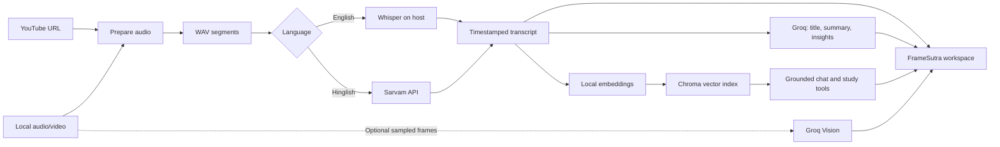
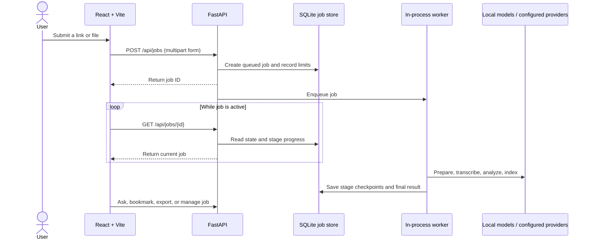

<div align="center">

# FrameSutra

### Every Frame Has a Story. Every Word Has an Answer.

AI-powered video understanding, transcription, summarization, and intelligent question answering, built with a local-first approach. Bring in a public YouTube link or a local recording to create a transcript, structured notes, optional visual observations, and a searchable chat workspace.

**Local-First AI · Video Intelligence · RAG-Powered**
Built with effort by **Akarsh Mishra**

The interface includes a site-wide light/dark switch, responsive layouts, and reduced-motion-aware pointer feedback.

[Get started](#-quick-start) · [Open the user manual](docs/USER_MANUAL.md) · [Product design](docs/PRODUCT_DESIGN.md) · [Explore the architecture](docs/ARCHITECTURE.md) · [API reference](docs/API_REFERENCE.md) · [Privacy and terms](docs/PRIVACY_AND_TERMS.md)

<p align="center"><a href="docs/visuals/pipeline-explorer.html"><strong>Open the interactive pipeline explorer ↗</strong></a> <small>(open the file in a browser from a local checkout)</small></p>

</div>

---

## At a glance

| | |
|---|---|
| **Interface** | React, Vite, and a local FastAPI service |
| **Input** | Public YouTube URLs or local audio/video uploads; batches support up to 3 sources |
| **Speech** | English transcription with local Whisper; Hinglish transcription and translation through Sarvam |
| **Analysis** | Groq language models for summaries, insights, chat, and study sets |
| **Search** | Local sentence-transformer embeddings and a persistent Chroma index |
| **Storage** | Local uploads/downloads, SQLite job history, transcript caches, and vector data |
| **Intended deployment** | A single-user local workspace; public production deployment needs additional security and operations work |

> **Data note:** “Local-first” does not mean fully offline. English transcription and vector search run on the host. Depending on the features selected, audio can be sent to Sarvam, and transcript excerpts, prompts, or optional video frames can be sent to Groq. Read the [privacy and data-flow guide](docs/PRIVACY_AND_TERMS.md) before processing sensitive media.

> **Compatibility note:** Existing installations keep the SQLite filename `videolens.sqlite3` so the rebrand does not disconnect saved local analyses. This is an internal legacy filename; the product name and interface are FrameSutra.

## What you can do

<details open>
<summary><strong>Analyze and review a video</strong></summary>

- Submit a public YouTube link or upload audio/video supported by the server’s FFmpeg installation.
- Select English or Hinglish processing.
- Optionally analyze sampled frames from a local video.
- Follow queued, active, completed, failed, interrupted, and cancelled job states.
- Review summary, action items, decisions, open questions, transcript, visual notes, chapters, and study material.
- Ask questions against the current analysis and inspect cited excerpts and timestamps.
</details>

<details>
<summary><strong>Manage, revisit, and export work</strong></summary>

- Search the local analysis library, save an analysis, retry eligible jobs, and delete jobs.
- Add and remove transcript bookmarks; edit generated chapter titles.
- Export a transcript, Markdown or JSON report, or a PDF notes package.
- Generate flashcards, key terms, or a fresh ten-question quiz.
- Inspect queue and disk metrics, run retention cleanup, or clear reusable caches.
</details>

## How the pipeline works





## Quick start

### 1. Install prerequisites

- Python 3.10 or later; Python 3.12 is a practical choice for the included dependencies.
- Node.js and npm for the React interface.
- FFmpeg and ffprobe available on `PATH` for audio conversion and optional frame sampling.
- A Groq API key for analysis, chat, study sets, and PDF review questions.
- A Sarvam API key only if you need Hinglish processing.

### 2. Create a Python environment

```powershell
py -3.12 -m venv .venv
.\.venv\Scripts\Activate.ps1
python -m pip install --upgrade pip
python -m pip install -r Requirements.txt
```

If PowerShell blocks activation, call the environment interpreter directly: `.\.venv\Scripts\python.exe -m pip install -r Requirements.txt`.

### 3. Configure provider keys

```powershell
Copy-Item .env.example .env
```

Open `.env` and set `GROQ_API_KEY`. Add `SARVAM_API_KEY` when enabling Hinglish. Keep `.env` private and out of Git.

### 4. Start the API and web interface

In a project-root terminal:

```powershell
python -m uvicorn api:app --host 127.0.0.1 --port 8000 --reload
```

In a second terminal:

```powershell
cd frontend
npm install
npm run dev
```

Open the local URL printed by Vite, usually <http://localhost:5173>. The API health endpoint is <http://127.0.0.1:8000/api/health>; interactive API documentation is at <http://127.0.0.1:8000/docs>.

<details>
<summary><strong>Alternative: start the legacy Streamlit interface</strong></summary>

The repository also includes `app.py` and `run.bat` for the earlier Streamlit UI. Install the Python requirements, configure `.env`, then run `streamlit run app.py` or use `run.bat` on Windows. The React + FastAPI interface is the primary documented experience.
</details>

## Documentation map

| Document | Use it for |
|---|---|
| [User manual](docs/USER_MANUAL.md) | Step-by-step instructions for analysis, results, library, study tools, exports, and system controls |
| [Product design](docs/PRODUCT_DESIGN.md) | Visual map, interaction states, layout, and design tokens |
| [Interactive pipeline explorer](docs/visuals/pipeline-explorer.html) | Clickable stage-by-stage data-flow visual; open from a local checkout |
| [Architecture](docs/ARCHITECTURE.md) | Components, processing flow, job lifecycle, data stores, and source-code map |
| [API reference](docs/API_REFERENCE.md) | Routes, parameters, examples, error behavior, and local trust model |
| [Configuration and operations](docs/OPERATIONS.md) | Setup, environment variables, retention, backup/reset, and troubleshooting |
| [Privacy, terms, and user agreement](docs/PRIVACY_AND_TERMS.md) | Data handling, provider transfers, user responsibilities, and practical limitations |
| [Project report](docs/PROJECT_REPORT.md) | Project abstract, goals, design, implementation, results, risks, and future work |
| [Deployment guide](FrameSutra_DEPLOYMENT.md) | Private local deployment and considerations for a controlled host |
| [System design](SYSTEM_DESIGN.md) | Queue defaults, retention, retry behavior, provider counters, and operating limits |

## Repository map

```text
.
├── api.py                     FastAPI routes, worker lifecycle, exports, cleanup
├── app.py                     Legacy Streamlit interface
├── core/
│   ├── analyzer.py            Structured transcript analysis
│   ├── config.py              Project paths and environment loading
│   ├── job_store.py           SQLite jobs, checkpoints, chats, bookmarks, limits
│   ├── llm_provider.py        Groq client and retry behavior
│   ├── observability.py       Process-local provider/cache counters
│   ├── rag_engine.py          Retrieval and transcript-grounded answers
│   ├── transcriber.py         Whisper and Sarvam transcription
│   ├── vector_store.py        Embeddings and Chroma operations
│   └── visual_analyzer.py     Optional local frame extraction and descriptions
├── frontend/
│   ├── src/App.jsx            React screens and user interactions
│   ├── src/styles.css         Main interface styling
│   ├── src/overrides.css      Supplemental component styling
│   └── vite.config.js         Local API proxy
├── utils/audio_processor.py   YouTube/local media acquisition and audio chunks
├── docs/                      User, architecture, API, operations, and report docs
├── Requirements.txt           Python dependencies
└── .env.example               Provider and service configuration template
```

## Defaults and limits

| Setting | Default | Meaning |
|---|---:|---|
| Worker processes | 1 | One FastAPI process with an in-process worker pool |
| Outstanding jobs | 3 | Queued plus active job capacity |
| Batch size | 3 | Maximum sources in one batch submission |
| Upload size | 512 MB | Per-upload limit |
| Media duration | 6 hours | Maximum duration accepted by default |
| Job submissions | 5 per hour and one per 20 seconds | Per local client identity (derived from request IP) |
| Chat/study requests | 15 per minute | Per local client identity |
| Unsaved job retention | 30 days | Saved jobs are excluded from automatic job expiry |
| Media retention | 7 days | Automatic cleanup of generated/source media files |

These are configurable. See [`.env.example`](.env.example) and the [configuration guide](docs/OPERATIONS.md). Provider pricing, free tiers, model availability, YouTube behavior, and downloaded model sizes can change independently of this repository.

## Important boundaries

- This is a local, single-user application, not an authenticated public service. Do not expose the API directly to the Internet.
- English transcription, media preparation, embeddings, and retrieval run on the host. Provider-backed features send the corresponding content to configured external services.
- Timestamps are speech-segment or approximate chunk timestamps, not guaranteed word-level alignments.
- Visual analysis is opt-in and currently applies to local video uploads; selected frames are sent to the configured vision model.
- Model output can be incomplete or incorrect. Check important details against the original source.
- A single in-process worker setup is not high-availability infrastructure. Long jobs depend on host uptime, disk space, provider quotas, and network access.

See [known limitations and troubleshooting](docs/OPERATIONS.md#troubleshooting) before relying on the app for long recordings.

## Contributing and reporting issues

Keep generated data, model caches, secrets, and uploaded media out of commits. Before changing behavior, update the relevant documentation and verify the affected interface/build locally. Project credit: built with effort by Akarsh Mishra. A public support address, software license, legal jurisdiction, and contribution policy have not been provided; add and review those details before presenting the project as a public service or redistributing it.

---

<div align="center">

**FrameSutra · AI-assisted video review, built for a local workspace.**

</div>
