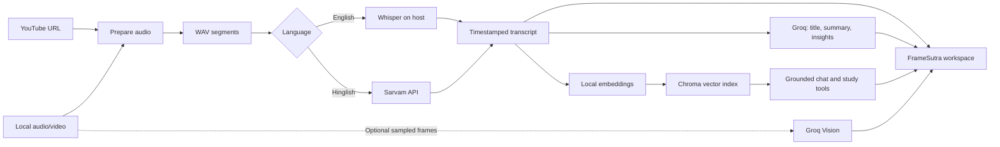
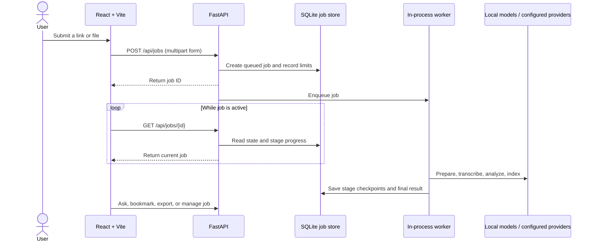

<div align="center">


# FrameSutra

### *Every Frame Has a Story. Every Word Has an Answer.*

<p>
  <a href="LICENSE"></a>
  
  
  
</p>

**An AI-powered workspace for understanding video.** Bring in a public YouTube link or a local recording to create a searchable transcript, structured notes, optional visual observations, and source-grounded answers—all from a workspace designed to run on your own machine.

**Built with effort by [Akarsh Mishra](https://github.com/Code-AkarshMishra).**

The React interface includes a site-wide light/dark theme, responsive layouts, and reduced-motion-aware pointer feedback.

[🚀 Quick start](#quick-start) · [📘 User manual](docs/USER_MANUAL.md) · [🧭 Architecture](docs/ARCHITECTURE.md) · [🔌 API reference](docs/API_REFERENCE.md) · [🛡️ Privacy and terms](docs/PRIVACY_AND_TERMS.md)

<p align="center"><a href="docs/visuals/pipeline-explorer.html"><strong>🧩 Open the interactive pipeline explorer ↗</strong></a> <small>(open from a local checkout)</small></p>

<p align="center"></p>

</div>

---

<details>
<summary><strong>🗺️ Browse this README</strong></summary>

1. [At a glance](#at-a-glance)
2. [What you can do](#what-can-you-do)
3. [How the pipeline works](#how-the-pipeline-works)
4. [Quick start](#quick-start)
5. [Documentation map](#documentation-map)
6. [Repository map](#repository-map)
7. [Defaults and limits](#defaults-and-limits)
8. [Configuration reference](#configuration-reference)
9. [Where your data goes](#where-your-data-goes)
10. [Important boundaries](#important-boundaries)
11. [Contributing and reporting issues](#contributing-and-reporting-issues)

</details>

## At a glance

| | |
|---|---|
| **Interface** | React, Vite, and a local FastAPI service |
| **Input** | Public YouTube URLs or local audio/video uploads; batches support up to 3 sources |
| **Speech** | English transcription with local Whisper; Hinglish transcription and translation through Sarvam |
| **Analysis** | Groq language models for summaries, insights, chat, and study sets |
| **Search** | Local sentence-transformer embeddings and a persistent Chroma index |
| **Storage** | Local uploads/downloads, SQLite job history, transcript caches, and vector data |
| **Intended deployment** | A single-user local workspace; public production deployment needs additional security and operations work |

> **Data note:** “Local-first” does not mean fully offline. English transcription and vector search run on the host. Depending on the features selected, audio can be sent to Sarvam, and transcript excerpts, prompts, or optional video frames can be sent to Groq. Read the [privacy and data-flow guide](docs/PRIVACY_AND_TERMS.md) before processing sensitive media.

> **Use responsibly:** Only process videos you own or are authorized to use. You are responsible for respecting copyright, privacy, consent, provider terms, and local laws. FrameSutra is an assistive tool; check important claims against the source video.

> **Compatibility note:** Existing installations keep the SQLite filename `videolens.sqlite3` so the rebrand does not disconnect saved local analyses. This is an internal legacy filename; the product name and interface are FrameSutra.

## What you can do

| ✨ Understand | 🔎 Explore | 📚 Learn | 📦 Keep control |
|---|---|---|---|
| Summaries, decisions, action items, chapters, and optional visual notes | Transcript search, timestamped excerpts, and grounded chat | Flashcards, key terms, and quizzes from the source | Local job history, exports, saved analyses, cleanup, and reset controls |

<details open>
<summary><strong>Analyze and review a video</strong></summary>

- Submit a public YouTube link or upload audio/video supported by the server’s FFmpeg installation.
- Select English or Hinglish processing.
- Optionally analyze sampled frames from a local video.
- Follow queued, active, completed, failed, interrupted, and cancelled job states.
- Review summary, action items, decisions, open questions, transcript, visual notes, chapters, and study material.
- Ask questions against the current analysis and inspect cited excerpts and timestamps.
</details>

<details>
<summary><strong>Manage, revisit, and export work</strong></summary>

- Search the local analysis library, save an analysis, retry eligible jobs, and delete jobs.
- Add and remove transcript bookmarks; edit generated chapter titles.
- Export a transcript, Markdown or JSON report, or a PDF notes package.
- Generate flashcards, key terms, or a fresh ten-question quiz.
- Inspect queue and disk metrics, run retention cleanup, or clear reusable caches.
</details>

## How the pipeline works





## Quick start

### 1. Install prerequisites

- Python 3.10 or later; Python 3.12 is a practical choice for the included dependencies.
- Node.js and npm for the React interface.
- FFmpeg and ffprobe available on `PATH` for audio conversion and optional frame sampling.
- A Groq API key for analysis, chat, study sets, and PDF review questions.
- A Sarvam API key only if you need Hinglish processing.

### 2. Install the backend

```powershell
py -3.12 -m venv .venv
.\.venv\Scripts\Activate.ps1
.\.venv\Scripts\python.exe -m pip install --upgrade pip
.\.venv\Scripts\python.exe -m pip install -r Requirements.txt
```

If you already have a compatible environment at `.venv312`, the Windows launcher can use it automatically.

### 3. Configure provider keys

```powershell
if (-not (Test-Path .env)) { Copy-Item .env.example .env }
```

Open `.env` and set `GROQ_API_KEY`. Add `SARVAM_API_KEY` when enabling Hinglish. Keep `.env` private and out of Git. `start.bat` creates `.env` from the example only when it does not already exist; it never replaces an existing configuration.

### 4. Start the API and web interface

On Windows, install and start the web app with one command:

```powershell
start.bat
```

The launcher checks for Python, backend packages, Node.js, and npm. If frontend dependencies are missing, it installs the versions in `frontend/package-lock.json`, then opens separate API and web-service windows. Keep those windows open while using the app.

To run services manually in separate terminals:

```powershell
\.venv\Scripts\python.exe -m uvicorn api:app --host 127.0.0.1 --port 8000 --reload
```

```powershell
npm ci --prefix frontend
npm run dev --prefix frontend
```

Open <http://localhost:5173>. The API health endpoint is <http://127.0.0.1:8000/api/health>; interactive API documentation is at <http://127.0.0.1:8000/docs>.

<details>
<summary><strong>macOS and Linux: start the services manually</strong></summary>

```bash
python3 -m venv .venv
.venv/bin/python -m pip install --upgrade pip
.venv/bin/python -m pip install -r Requirements.txt
test -f .env || cp .env.example .env
# Add provider keys to .env, then use separate terminals:
.venv/bin/python -m uvicorn api:app --host 127.0.0.1 --port 8000 --reload
npm ci --prefix frontend
npm run dev --prefix frontend
```

</details>

<details>
<summary><strong>Alternative: start the legacy Streamlit interface</strong></summary>

The repository also includes `app.py` and `run.bat` for the earlier Streamlit UI. Install the Python requirements, configure `.env`, then run `streamlit run app.py` or use `run.bat` on Windows. The React + FastAPI interface started by `start.bat` is the primary experience.
</details>

### First-run notes

- Whisper and sentence-transformer model weights download on first use; the initial analysis can take longer and use substantial disk space.
- The API binds to `127.0.0.1` by default. Keep it local unless you have deliberately added authentication, TLS, and deployment safeguards.
- FFmpeg is an external executable. Installing Python packages alone does not install FFmpeg or ffprobe.
- YouTube availability and supported formats can change; a public URL is not guaranteed to be downloadable.

## Documentation map

| Document | Use it for |
|---|---|
| [User manual](docs/USER_MANUAL.md) | Step-by-step instructions for analysis, results, library, study tools, exports, and system controls |
| [Product design](docs/PRODUCT_DESIGN.md) | Visual map, interaction states, layout, and design tokens |
| [Interactive pipeline explorer](docs/visuals/pipeline-explorer.html) | Clickable stage-by-stage data-flow visual; open from a local checkout |
| [Architecture](docs/ARCHITECTURE.md) | Components, processing flow, job lifecycle, data stores, and source-code map |
| [API reference](docs/API_REFERENCE.md) | Routes, parameters, examples, error behavior, and local trust model |
| [Configuration and operations](docs/OPERATIONS.md) | Setup, environment variables, retention, backup/reset, and troubleshooting |
| [Privacy, terms, and user agreement](docs/PRIVACY_AND_TERMS.md) | Data handling, provider transfers, user responsibilities, and practical limitations |
| [Project report](docs/PROJECT_REPORT.md) | Project abstract, goals, design, implementation, results, risks, and future work |
| [Deployment guide](FrameSutra_DEPLOYMENT.md) | Private local deployment and considerations for a controlled host |
| [System design](SYSTEM_DESIGN.md) | Queue defaults, retention, retry behavior, provider counters, and operating limits |

## Repository map

```text
.
├── api.py                     FastAPI routes, worker lifecycle, exports, cleanup
├── app.py                     Legacy Streamlit interface
├── start.bat                  Windows launcher for the React + FastAPI app
├── run.bat                    Windows launcher for the legacy Streamlit app
├── main.py                    Optional command-line analysis flow
├── check_setup.py             Local provider-key and FFmpeg readiness report
├── core/
│   ├── analyzer.py            Structured transcript analysis
│   ├── config.py              Project paths and environment loading
│   ├── job_store.py           SQLite jobs, checkpoints, chats, bookmarks, limits
│   ├── llm_provider.py        Groq client and retry behavior
│   ├── observability.py       Process-local provider/cache counters
│   ├── rag_engine.py          Retrieval and transcript-grounded answers
│   ├── transcriber.py         Whisper and Sarvam transcription
│   ├── vector_store.py        Embeddings and Chroma operations
│   └── visual_analyzer.py     Optional local frame extraction and descriptions
├── frontend/
│   ├── src/App.jsx            React screens and user interactions
│   ├── src/styles.css         Main interface styling
│   ├── src/overrides.css      Supplemental component styling
│   └── vite.config.js         Local API proxy
├── utils/audio_processor.py   YouTube/local media acquisition and audio chunks
├── docs/
│   ├── assets/                FrameSutra SVG logo and README banner
│   └── ...                    User, architecture, API, operations, and report docs
├── .gitattributes             Consistent text and Windows batch line endings
├── Requirements.txt           Python dependencies
└── .env.example               Provider and service configuration template
```

## Defaults and limits

| Setting | Default | Meaning |
|---|---:|---|
| Worker processes | 1 | One FastAPI process with an in-process worker pool |
| Outstanding jobs | 3 | Queued plus active job capacity |
| Batch size | 3 | Maximum sources in one batch submission |
| Upload size | 512 MB | Per-upload limit |
| Media duration | 6 hours | Maximum duration accepted by default |
| Job submissions | 5 per hour and one per 20 seconds | Per local client identity (derived from request IP) |
| Chat/study requests | 15 per minute | Per local client identity |
| Unsaved job retention | 30 days | Saved jobs are excluded from automatic job expiry |
| Media retention | 7 days | Automatic cleanup of generated/source media files |

These are configurable. See [`.env.example`](.env.example) and the [configuration guide](docs/OPERATIONS.md). Provider pricing, free tiers, model availability, YouTube behavior, and downloaded model sizes can change independently of this repository.

## Configuration reference

Set these in the root `.env` file. The backend reads it at startup; restart the API after changing a value. Do not put real credentials in `.env.example` or commit `.env`.

| Variable | Example value | Used for |
|---|---|---|
| `GROQ_API_KEY` | *(your key)* | Required for summaries, analysis, grounded chat, study tools, and PDF questions |
| `GROQ_MODEL` | `llama-3.1-8b-instant` | Optional text model override; check model availability with your provider |
| `GROQ_VISION_MODEL` | `meta-llama/llama-4-scout-17b-16e-instruct` | Optional vision model for sampled frames from local video |
| `SARVAM_API_KEY` | *(your key)* | Required only for Hinglish transcription/translation |
| `SARVAM_STT_MODEL` | `saaras:v2.5` | Sarvam speech-to-text model |
| `WHISPER_MODEL` | `small` | Local English transcription model; larger choices need more memory and disk |
| `VIDEO_JOB_WORKERS` | `1` | In-process worker count; keep one API process for the local job store |
| `MAX_OUTSTANDING_JOBS` | `3` | Queued plus active job capacity |
| `MAX_UPLOAD_MB` | `512` | Maximum upload size per source |
| `MAX_MEDIA_HOURS` | `6` | Maximum accepted source duration |
| `JOB_HOURLY_LIMIT` | `5` | Local job submission limit per client per hour |
| `CHAT_PER_MINUTE_LIMIT` | `15` | Chat and study request limit per client per minute |
| `JOB_RETENTION_DAYS` | `30` | Expiry age for unsaved job records |
| `MEDIA_RETENTION_DAYS` | `7` | Retention window for generated/source media cleanup |
| `FRONTEND_ORIGINS` | `http://localhost:5173,http://127.0.0.1:5173` | Browser origins allowed to call the API |

The committed `.env.example` is the authoritative starter template. For model defaults, rate limits, retention behavior, and provider notes, see [Operations and configuration](docs/OPERATIONS.md).

## Where your data goes

| Data or feature | Processing location |
|---|---|
| Media conversion and English Whisper transcription | Your computer |
| Embeddings and transcript retrieval | Your computer; stored in the local Chroma index |
| Hinglish transcription | Audio is sent to the configured Sarvam service |
| Summaries, analysis, chat, study sets | Relevant transcript text or excerpts are sent to the configured Groq service |
| Optional visual analysis | Selected frames from local video are sent to the configured Groq vision model |
| Job history, bookmarks, chats, and saved results | Local SQLite database |

Review the full [privacy notice, terms, and user agreement](docs/PRIVACY_AND_TERMS.md) before uploading confidential or personal recordings. Local storage still needs protection: anyone with access to your account or project folders may be able to read it.

## Important boundaries

- This is a local, single-user application, not an authenticated public service. Do not expose the API directly to the Internet.
- English transcription, media preparation, embeddings, and retrieval run on the host. Provider-backed features send the corresponding content to configured external services.
- Timestamps are speech-segment or approximate chunk timestamps, not guaranteed word-level alignments.
- Visual analysis is opt-in and currently applies to local video uploads; selected frames are sent to the configured vision model.
- Model output can be incomplete or incorrect. Check important details against the original source.
- A single in-process worker setup is not high-availability infrastructure. Long jobs depend on host uptime, disk space, provider quotas, and network access.

See [known limitations and troubleshooting](docs/OPERATIONS.md#troubleshooting) before relying on the app for long recordings.

## Contributing and reporting issues

Bug reports are most useful with the affected screen or API route, steps to reproduce, expected behavior, and sanitized logs. Never attach `.env`, API keys, private media, transcripts, or database files to an issue.

For code changes, keep commits focused, update relevant documentation, and keep generated data, model caches, secrets, and uploaded media out of Git. This project is distributed under the [MIT License](LICENSE). Third-party packages, models, and AI providers keep their own licenses and terms.

---

<div align="center">

**FrameSutra · Local-first AI · Video intelligence · RAG-powered**<br />
Every frame has a story. Every word has an answer.

</div>
