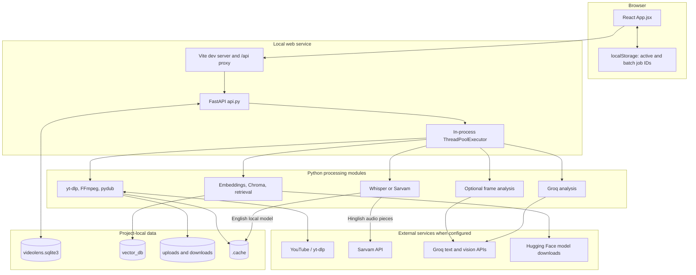
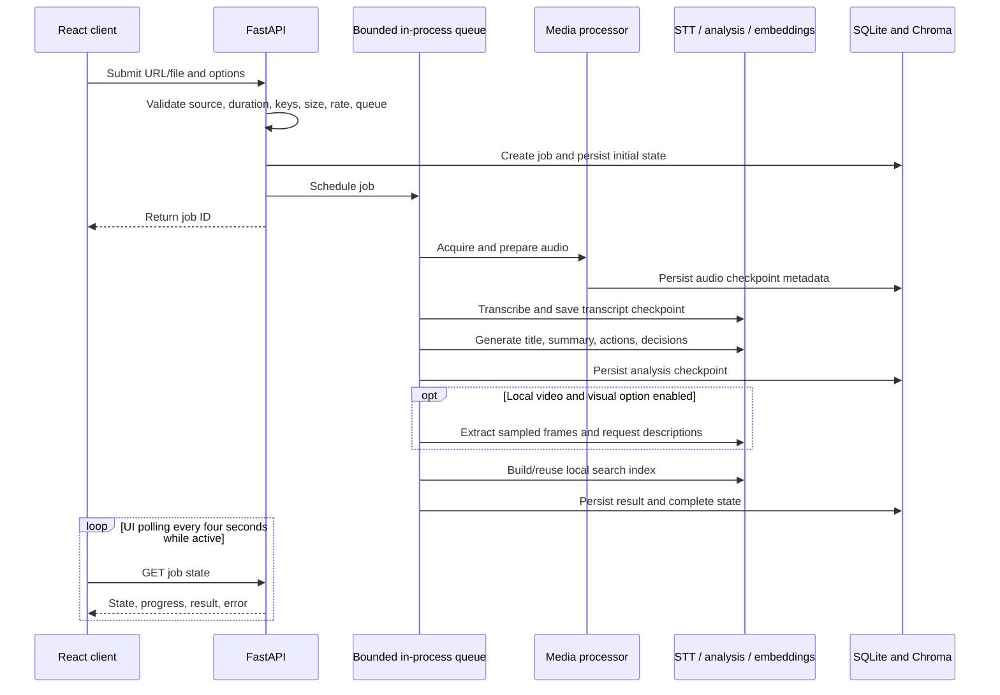

# FrameSutra architecture

FrameSutra is a local-first web application with a React/Vite interface, a FastAPI backend, a Python media/AI pipeline, SQLite job persistence, and a local Chroma vector index. A Streamlit UI remains at the repository root as a legacy alternative.

## Component view

## Processing sequence

## Job lifecycle and resilience

- `api.py` creates queued jobs and schedules `_run_job` using the configured executor.
- Stage state and stage duration are written to SQLite while work progresses.
- Audio, transcript, analysis, and visual results are saved as checkpoints. Retry creates a new job referencing reusable checkpoints.
- After an API restart, queued/running jobs are marked interrupted by store initialization; they remain eligible for checkpoint-based retry where possible.
- Cancellation sets a request flag and is checked between stages and transcription chunks. It cannot force-stop an active native model/provider/media call.
- One API process is the expected operating mode. Multiple Uvicorn workers each create an independent executor and in-memory RAG-chain cache.

## Storage model

| Location | Contents | Notes |
|---|---|---|
| `videolens.sqlite3` | Jobs, stage state, result/checkpoints, rate-limit events, chats, bookmarks, study sets, answer cache | SQLite uses WAL mode; stop the API before copying the database and WAL/SHM files for a consistent backup. |
| `vector_db/` | Chroma collections containing embeddings and transcript/visual text chunks | Local persistent retrieval index. Job deletion removes an unused associated collection. |
| `uploads/` | Uploaded source media while retained | Created by API startup; media cleanup defaults to seven days. |
| `downloads/` | Prepared YouTube audio, job media, audio chunks, and sampled video frames | Avoid committing; may contain copyrighted or private content. |
| `.cache/` | Transcript and analysis outputs, reusable provider/media-stage data | Cache-clear endpoint removes selected cache families; model caches may live elsewhere. |
| Browser `localStorage` | Active job and batch IDs, theme preference | Does not contain the complete job result. Previous `videolens.*` job ID keys are migrated on first load so the rebrand keeps active local jobs available. |

The SQLite database keeps the legacy filename `videolens.sqlite3` to remain compatible with existing local records. It is an internal storage filename; all current product branding is FrameSutra.

## Pipeline stages

1. **Source validation:** YouTube domains are checked; local uploads are saved under a generated name; duration and configured byte limits are enforced.
2. **Audio preparation:** `utils/audio_processor.py` uses `yt-dlp`, FFmpeg, and pydub. The input is converted/split into manageable audio segments. YouTube ingestion requests audio-only media.
3. **Transcription:** `core/transcriber.py` selects local Whisper for English or the Sarvam speech-to-text/translation endpoint for Hinglish. Sarvam audio is sliced into 25-second pieces due to the endpoint request limit.
4. **Structured analysis:** `core/analyzer.py` produces a title, summary, action items, decisions, and open questions using the configured Groq model. Long input uses chunked/map-reduce handling and caches where available.
5. **Optional visuals:** `core/visual_analyzer.py` samples up to a configured number of frames across a local video, filters near-duplicates locally, and sends selected images to the configured vision model.
6. **Retrieval index:** `core/vector_store.py` creates/reuses local sentence-transformer embeddings and a Chroma collection; `core/rag_engine.py` retrieves evidence and generates answers.
7. **Results and tools:** the API persists results and exposes chat, chapters, bookmarks, study material, PDF, transcript, Markdown/JSON exports, and job management.

## Code map

| Path | Responsibility |
|---|---|
| `api.py` | HTTP routes, job admission, background task scheduling, polling data, library, study, PDF, cleanup, metrics |
| `core/job_store.py` | SQLite schema and job/chat/bookmark/study/checkpoint operations |
| `core/analyzer.py` | Transcript analysis and long-transcript handling |
| `core/transcriber.py` | Whisper timing and Sarvam speech requests |
| `core/llm_provider.py` | Groq model configuration and rate-limit retries |
| `core/vector_store.py` | Local embeddings, collection naming, Chroma indexing |
| `core/rag_engine.py` | Evidence retrieval and grounded chat |
| `core/visual_analyzer.py` | Local FFmpeg frame sampling and optional vision requests |
| `core/observability.py` | Process-local provider/cache/job counters |
| `utils/audio_processor.py` | YouTube/local source preparation and audio chunk creation |
| `frontend/src/App.jsx` | React screens, forms, result views, library, system page, legal dialogs |
| `frontend/src/styles.css` and `overrides.css` | Interface and responsive styling |
| `app.py` | Legacy Streamlit interface |

## Design choices and limits

- **SQLite instead of a managed database:** zero additional service setup for a local single-user project; it is not a multi-host queue or high-availability store.
- **Local embeddings and vector search:** transcript retrieval stays on the host; answer generation still uses Groq and sends the retrieved excerpts to that provider.
- **Checkpointed jobs:** support recovery from completed stages but depend on retained files and model/provider availability.
- **IP-derived owner identity:** convenient for local use, not authentication or tenant isolation.
- **Browser polling:** the interface polls active jobs every four seconds; this is simple and suitable for a small local queue, not large-scale event streaming.
- **Timestamp quality varies:** Whisper segment-level marks for new English jobs; approximate chunk markers for Hinglish and older records. No word-level alignment is implemented.

For concrete defaults and queue constraints, see [System Design](../SYSTEM_DESIGN.md). For route details, see the [API reference](API_REFERENCE.md).
