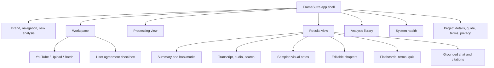

# FrameSutra product design

This page documents the current React interface’s structure, visual system, and interaction model. It is a design reference for future interface changes, not a separate prototype.

## Experience goals

- Make a long media task understandable before processing starts.
- Keep progress, limits, and failure recovery visible.
- Let users move between generated notes and the transcript evidence.
- Make local storage and external provider use clear before a user submits media.
- Keep the same core tasks available on narrow screens.

## Page map

## Visual system

| Role | Current value | Typical use |
|---|---|---|
| Ink | `#202a3d` | Primary headings and text |
| Muted text | `#768196` / nearby shades | Labels, helper text, metadata |
| Page paper | `#f5f7fb` | Main application background |
| Primary blue | `#5559e8` | Primary actions, selected tabs, links |
| Success green | `#16a47b` | Completion and ready states |
| Coral | `#ef775f` | Errors and selected warnings |
| Purple | `#8c69db` | Study and secondary insight accents |
| Borders | `#e5e9f0` / nearby shades | Cards, separators, form boundaries |

The React interface also has a deep navy dark theme with the same blue-violet accent. The header control persists the choice in browser storage and follows it across app screens. A subtle pointer halo responds to movement/clicks on pointer devices; it is disabled for touch input and reduced-motion preferences.

The interface uses rounded white cards, quiet borders, muted metadata, a blue primary action, and responsive CSS layouts. Main styling is in `frontend/src/styles.css`; the newer footer, legal dialogs, and mobile navigation refinements are in `frontend/src/overrides.css`.

## Interaction states

| Component | States and behavior |
|---|---|
| Source picker | YouTube, upload, batch; selected mode controls required fields |
| Agreement | Required checkbox; opens the User Agreement and Privacy Policy dialogs |
| Job progress | Queued, running stage, complete, skipped stage, failed, interrupted, cancelled |
| Result tabs | Overview, Transcript, Visuals, Chapters, Study, Ask video |
| Library row | Open, save/unsave, retry when available, delete with confirmation |
| Study tools | Flashcards, key terms, quiz; quiz supports answer selection and score evaluation |
| System controls | Run retention cleanup and clear reusable caches |
| Legal dialog | Open from workspace checkbox or footer; close with close button, Escape, or backdrop click |
| Responsive navigation | Desktop navigation remains visible; narrow layouts use the menu button |

## Responsive layout

- Wide screens use a two-column hero/workspace arrangement, multi-column feature cards, and split result panels.
- Tablet widths reduce horizontal padding and gaps.
- Narrow screens stack the workspace and result cards, turn the navigation into a menu, and make footer links visible.
- Reduced-motion preferences disable most transitions and animated loading duration.

## Accessibility notes

The current UI includes labels for file inputs and form fields, `aria-label` on icon-only controls, modal dialog roles, an Escape key handler, and reduced-motion styles. Future changes should preserve keyboard reachability, focus visibility, meaningful accessible names, and clear progress/error announcements. A full screen-reader and color-contrast audit has not been documented as completed.

## Design assets and documentation interaction

There are no external mockup files or screenshots in the repository. Mermaid diagrams in the Markdown documentation are rendered visually by GitHub and compatible viewers. `
` sections in the README and guides provide expandable instructions. The diagrams link to source concepts rather than embedding generated images, so they remain editable alongside the implementation.
