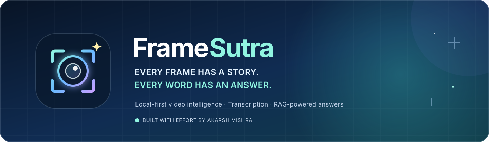
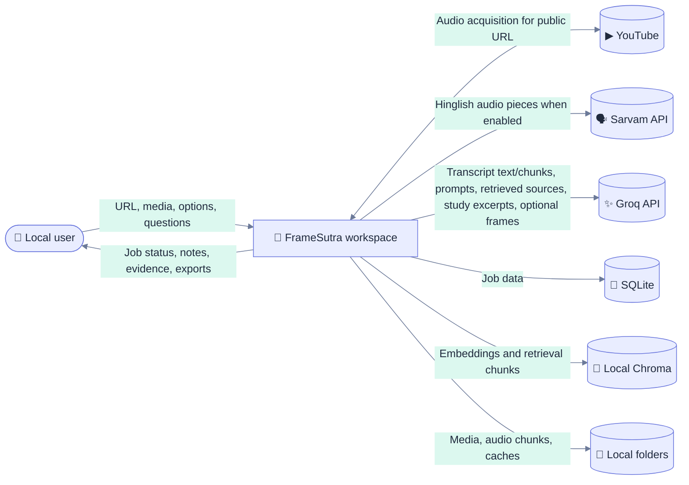
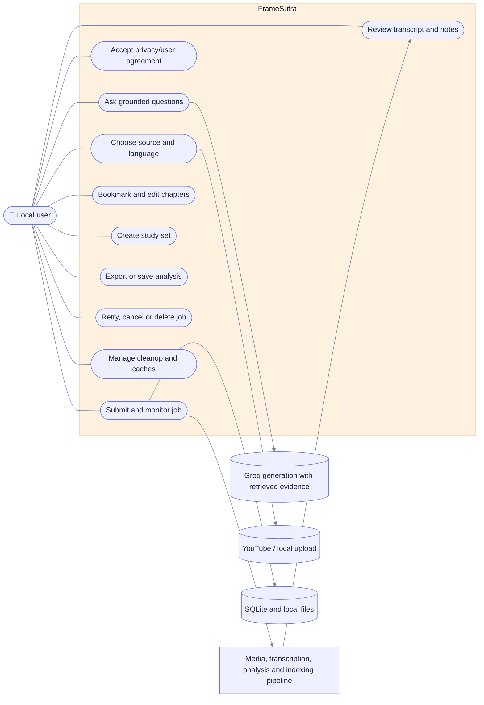
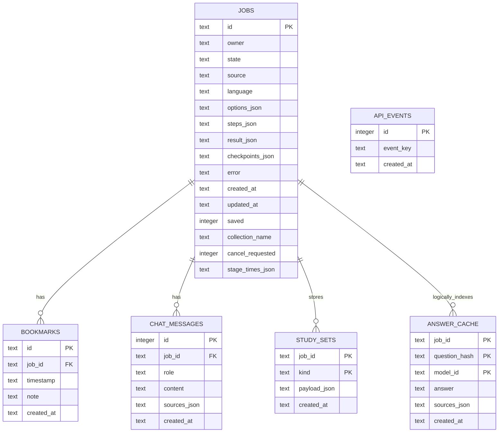
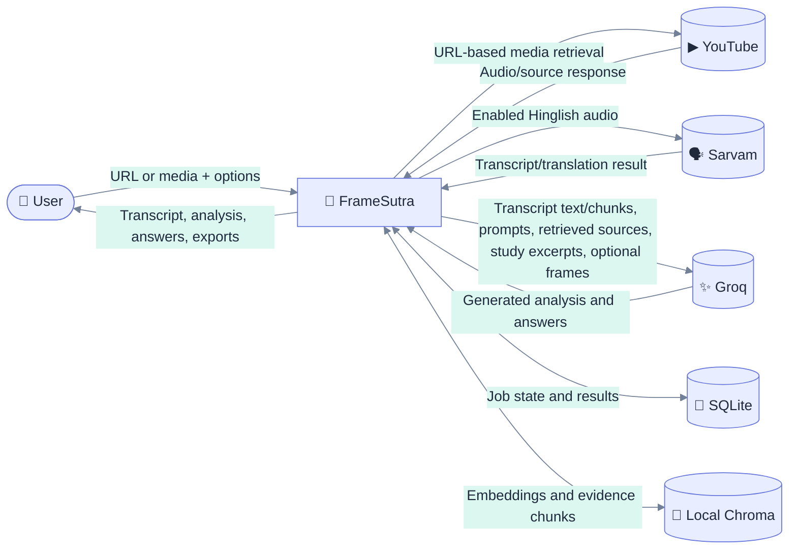
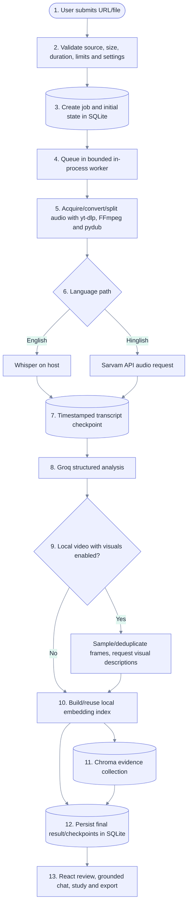
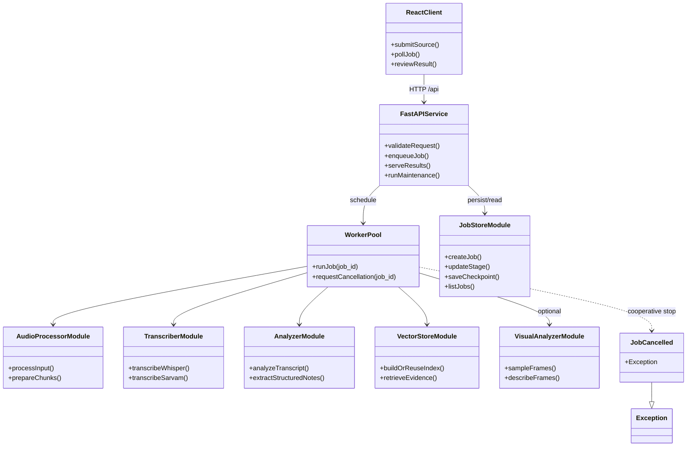
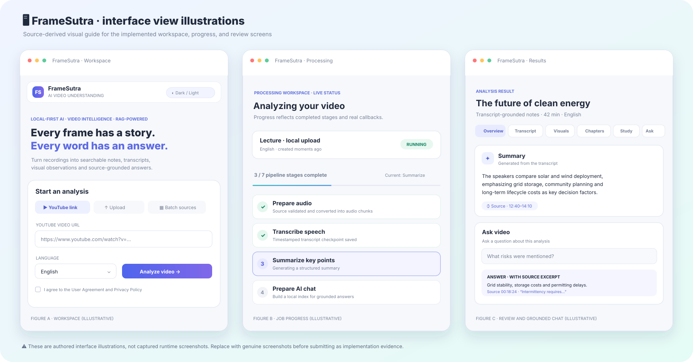

# 📘 FrameSutra

### Comprehensive Project Report · System Analysis · Product Study

**Local-First AI · Video Intelligence · RAG-Powered**

**Built with effort by Akarsh Mishra**

> **Document note:** Prepared from the repository’s implementation and documentation as of 25 October 2026. Institute, course, guide, enrollment number and approval details were not supplied; add them on the cover before formal academic submission. Pagination depends on the final export layout and is intentionally not fabricated here.

<strong>🧭 Interactive contents</strong>

- [Executive summary](#-executive-summary)
- [Chapter I · Introduction](#chapter-i--introduction)
- [Chapter II · Requirements analysis and feasibility](#chapter-ii--requirements-analysis-and-feasibility-study)
- [Chapter III · System analysis and design](#chapter-iii--system-analysis-and-design)
- [Chapter IV · Technology and testing](#chapter-iv--technology-and-testing)
- [Chapter V · Advantages and limitations](#chapter-v--advantages-and-limitations)
- [Chapter VI · Conclusion and further work](#chapter-vi--conclusion-and-suggestions-for-further-work)
- [References](#-references)
- [Companion product analysis](PRODUCT_ANALYSIS.md)
- [API reference](API_REFERENCE.md) · [User manual](USER_MANUAL.md) · [Architecture](ARCHITECTURE.md) · [Privacy and terms](PRIVACY_AND_TERMS.md)

---

## ✨ Executive summary

FrameSutra is a local-first application for turning long video or audio recordings into material that is easier to review. A person can submit a public YouTube URL, upload local media, or submit a small batch. The system prepares audio, transcribes it, generates structured notes, indexes transcript evidence, and presents the results in a browser interface. Optional sampled-frame analysis adds visual observations for local video files.

The primary experience combines a React/Vite frontend with a FastAPI backend. A bounded, in-process worker runs the analysis pipeline. SQLite stores job state and related records; Chroma stores local embeddings. English transcription uses Whisper on the host. Hinglish processing uses the configured Sarvam speech API. Groq is used for text analysis and optional vision descriptions. Therefore, **local-first is not synonymous with offline or provider-free**.

The project’s practical distinction is the integration of transcript-level analysis, time-linked evidence retrieval, study tools, exports, and local job management in one workspace. This report documents implemented behavior, requirements, design, feasibility, candidate business models, testing plans, and known limitations. It does not claim independent performance testing or academic user research.

**Keywords:** video understanding, speech recognition, transcription, retrieval-augmented generation, local-first, FastAPI, React, SQLite, Chroma, multimodal analysis.

# CHAPTER I · INTRODUCTION

## 1.1 Project name and overview

### FrameSutra

**Tagline:** *Every Frame Has a Story. Every Word Has an Answer.*

FrameSutra is an AI-assisted video and audio review workspace. It connects media preparation and transcription with structured analysis, searchable evidence, study material, and exportable notes. The user-facing project identity is FrameSutra; the repository retains a few compatibility names such as `videolens.sqlite3` so an existing local database can remain readable.

| Identity item | Description |
|---|---|
| Project name | FrameSutra |
| Category | Local-first video intelligence and transcript-grounded Q&A |
| Developed by | Akarsh Mishra |
| Primary interface | React single-page application |
| Local service | FastAPI/Python |
| Project repository | [Code-AkarshMishra/FrameSutra](https://github.com/Code-AkarshMishra/FrameSutra) |
| License in repository | MIT; third-party models, libraries and services retain their own terms |

### Project vision

Reduce the effort required to understand a long recording while keeping the transcript, source references, job history and generated files visible to the person running the local workspace.

## 1.2 Preface and project background

Recorded lectures, demonstrations, interviews and meetings contain useful information, but the information is locked inside a timeline. Rewatching an entire recording to find one decision is slow. A plain transcript makes the words searchable but may not expose the main ideas, action items or connections between a question and its supporting passage. A generic summary can be concise yet difficult to verify against the source.

FrameSutra addresses this workflow by combining:

1. **Media preparation** — accepts a supported local audio/video file or public YouTube URL and prepares audio segments.
2. **Speech transcription** — uses local Whisper for English and the configured Sarvam API path for Hinglish.
3. **Structured understanding** — asks a configured Groq text model for a title, summary, decisions, action items and open questions.
4. **Search and evidence** — embeds transcript sections locally, retrieves relevant passages and returns source excerpts with approximate timestamps.
5. **Review tools** — presents chapters, bookmarks, optional visual notes, chat, flashcards, key terms, quizzes and exports.
6. **Local operations** — stores job history and working data in local files, SQLite and Chroma; exposes progress, retry/cancel, cleanup and metrics controls.

### Problem description

People who review long recordings repeatedly face four linked problems: locating a topic takes time; remembering exact details is difficult; summaries can be hard to verify; and sensitive recordings may be uncomfortable to upload to an unknown service. Language choice adds another barrier when a recording mixes Hindi and English.

### Proposed solution

FrameSutra creates a searchable record from each supported source, generates organized notes, and lets the user ask questions against retrieved transcript evidence. It keeps core file handling, English transcription, embeddings and vector retrieval on the host while disclosing that selected features call external providers. The solution improves review speed and navigation; it does **not** guarantee perfect transcription, factual answers or privacy from every configured provider.

### Objectives

- Accept YouTube links and local audio/video inputs, including batches of up to three sources.
- Support English and Hinglish processing through the project’s configured paths.
- Produce summaries, action items, decisions, open questions and chapter groupings.
- Offer transcript search and retrieval-grounded chat with source excerpts and approximate times.
- Add optional frame sampling and visual descriptions for supported local video uploads.
- Make results reusable through a library, bookmarks, saved analyses, study tools and exports.
- Show job state, checkpoints, cancellation requests, retention controls and local system metrics.
- Explain the data flow and limitations before users process sensitive media.

### Scope and exclusions

**In scope:** local single-user web application, React/Vite UI, FastAPI routes, bounded in-process workers, SQLite persistence, local Chroma retrieval, media acquisition/preparation, transcription, provider-backed analysis, exports, maintenance controls and a legacy Streamlit interface.

**Out of scope in the current implementation:** login, account recovery, tenant separation, a distributed queue, production-grade multi-user security, word-level alignment, guaranteed diarization, guaranteed exact Hinglish timestamps, guaranteed model accuracy, and a public-service SLA.

## 1.3 Definition of project technologies

| Technology | Role in FrameSutra | Execution boundary |
|---|---|---|
| React | Builds the interactive workspace, job, result, library and system screens | Browser |
| Vite | Serves the frontend in development and proxies `/api` calls | Local Node.js process |
| FastAPI | Validates HTTP requests, exposes the API and documents routes | Local Python process |
| Uvicorn | Runs the ASGI application during local development | Local Python process |
| SQLite | Stores jobs, stage state, checkpoints, bookmarks, chats, study sets, answer cache and rate-limit events | Local project file, WAL mode |
| Chroma | Persists transcript/visual evidence collections for retrieval | Local `vector_db/` directory |
| Sentence Transformers | Creates normalized CPU embeddings with `all-MiniLM-L6-v2` | Local model, first-use download may be required |
| OpenAI Whisper | English speech transcription and segment-level timing | Local Python model; device selection is handled by the Whisper/PyTorch runtime, and fp16 is disabled |
| Sarvam API | Hinglish speech transcription/translation in the current integration | External provider; audio pieces are sent to the configured endpoint |
| Groq API | Structured text analysis, chat/study generation and optional visual descriptions | External provider; transcript text/chunks, prompts, retrieved excerpts or selected frames may be sent |
| yt-dlp | Acquires audio for supported public YouTube sources | Local process plus YouTube/network access |
| FFmpeg / ffprobe | Converts, segments, probes and samples media | External native executables on `PATH` |
| pydub | Handles audio segments and chunk manipulation | Local Python process with FFmpeg support |
| Streamlit | Provides the earlier alternate UI through `app.py` and `run.bat` | Local Python process |

**Retrieval-augmented generation (RAG)** is the pattern used for question answering: split and embed source material, retrieve relevant sections for a question, and provide those sections to a language model as context. In this project the embedding/index path is local; answer generation still uses the configured Groq service.

# CHAPTER II · REQUIREMENTS ANALYSIS AND FEASIBILITY STUDY

## 2.1 Requirements analysis

### 2.1.1 Information gathering and analysis method

The requirements in this report were derived from inspection of the current source tree, route declarations, SQLite schema, `.env.example`, frontend interactions, user manual, privacy notice, operations guide and system design. The feature list describes observed implementation. **No stakeholder interviews, surveys, controlled usability study or formal acceptance session are recorded in the repository.** Requirements below should therefore be treated as an implementation-based analysis, not as measured user-research findings.

The analysis considered these actors and inputs:

- **Local user:** provides media, reviews outputs, manages saved items and controls cleanup.
- **Configured AI providers:** Groq and Sarvam receive only the requests associated with enabled features.
- **YouTube:** external source for public URLs; availability and download behavior are outside project control.
- **Host environment:** Python, Node/npm, FFmpeg, disk, model cache and network access.
- **Browser:** keeps theme preference and active job identifiers in local storage.

### 2.1.2 Functional requirements

| ID | Requirement | Implemented behavior / verification source |
|---|---|---|
| FR-01 | Accept media sources | YouTube URL, supported local audio/video upload, and batch of up to three; `POST /api/jobs`, `/api/jobs/batch` |
| FR-02 | Validate submissions | Validate source type/domain, upload size, duration, language, job capacity and request limits |
| FR-03 | Prepare audio | Use yt-dlp/FFmpeg/pydub for acquisition, conversion and segment preparation |
| FR-04 | Transcribe speech | Local Whisper English path; Sarvam Hinglish path, with chunking and reusable stage data |
| FR-05 | Generate analysis | Produce title, summary, action items, decisions and open questions using configured text model |
| FR-06 | Report progress | Return job state, stage state, errors and persisted checkpoints for UI polling |
| FR-07 | Retry and cancel | Retry eligible jobs from available checkpoints; cancellation is cooperative at stage/chunk boundaries |
| FR-08 | Retrieve evidence | Create/reuse local embedding collection and answer questions from transcript/visual evidence |
| FR-09 | Show results | Overview, searchable transcript, optional visuals, chapters, study, and Ask video views |
| FR-10 | Manage library | Search, save/unsave, retry, open, and delete analyses and associated local data where possible |
| FR-11 | Keep personal review markers | Create/list/delete bookmarks and edit chapter titles |
| FR-12 | Generate study material | Generate flashcards, key terms and a ten-question quiz; flashcards/terms persist, quiz is ephemeral |
| FR-13 | Export findings | PDF notes, Markdown/JSON report, transcript text and retained audio chunks where available |
| FR-14 | Operate local data | Read metrics, run retention cleanup, clear selected caches, and use reset/backup guidance |
| FR-15 | Disclose terms | Present user agreement/privacy dialogs and require agreement before submitting work |
| FR-16 | Support theme and responsive use | Persist light/dark preference across React routes; provide responsive layouts and reduced-motion behavior |
| FR-17 | Offer alternate interface | Retain the older Streamlit app as a secondary entry point |

### 2.1.3 Non-functional requirements

#### 2.1.3.1 Hardware requirements

The repository does not contain a benchmark-derived minimum specification. The following figures are **planning guidance only**, not a certified requirement or tested service guarantee.

| Resource | Practical development guidance | Why it matters |
|---|---|---|
| CPU | Recent multi-core 64-bit processor; four cores is a reasonable starting point | Media conversion, Whisper inference and embedding are compute-intensive |
| Memory | 16 GB RAM is a practical target; smaller systems may need smaller models and shorter media | PyTorch, Whisper, sentence embeddings and browser tools can coexist in memory |
| Storage | Keep at least 20 GB free for environment, model downloads and working media when evaluating the project | Model size and media size vary; caches can grow over time |
| GPU | Optional; Whisper/PyTorch chooses its available device, while the embedding model is explicitly configured for CPU | A GPU is not required by the documented setup; no acceleration benchmark is claimed |
| Network | Required for provider-backed features and first-time package/model/source downloads | “Local-first” does not mean offline |

For an academic performance result, record the exact CPU, RAM, GPU, OS, model choices, source duration and available disk before testing. Do not report the guidance above as measured minimum hardware.

#### 2.1.3.2 Software requirements

| Component | Requirement |
|---|---|
| Operating system | Windows is supported by `start.bat`; macOS/Linux can run the services manually, but have not been represented as tested here |
| Python | 3.10+ in project requirements; a compatible installed version is needed for PyTorch/Whisper dependencies |
| Node.js and npm | Required for the React/Vite interface and `npm ci` |
| FFmpeg and ffprobe | Installed separately and available on the API process `PATH` |
| Browser | Modern browser with JavaScript, local storage and standard media controls |
| Provider credentials | Groq key for text analysis/chat/study; Sarvam key for Hinglish path; vision model configured for optional visual analysis |
| Network | Needed by provider calls, YouTube retrieval and first-run model/package downloads |
| Python packages | See `Requirements.txt`; includes FastAPI/Uvicorn, Whisper, LangChain, Chroma, sentence-transformers and Streamlit support |

#### 2.1.3.3 Usability requirements

- Keep the source-selection path understandable: YouTube, upload or batch.
- Explain language, optional visuals, limits and provider disclosure before submission.
- Show queued/running/completed/error/interrupted/cancelled states and pipeline stages.
- Keep results navigable across overview, transcript, visuals, chapters, study and chat.
- Provide a library for reopening, saving, retrying and deleting analyses.
- Offer clear controls for theme, exports, bookmarks, cache cleanup and data reset.
- Preserve keyboard names for controls, reduced-motion preferences and responsive layouts.
- Avoid implying that an AI summary or timestamp is a verified transcript fact.

These are design goals and source-derived capabilities. No formal accessibility or usability study is documented as completed.

#### 2.1.3.4 Security and privacy requirements

| Requirement | Current design / gap |
|---|---|
| Keep development service local by default | `start.bat` binds Uvicorn to `127.0.0.1`; do not expose it directly to the Internet |
| Protect provider credentials | Store keys in ignored `.env`; never commit or display their values |
| Limit large or excessive inputs | Configure byte, duration, queue, submission and chat limits; limits are not a substitute for authentication |
| Restrict access to data | Protect local database, uploads, downloads, cache, vector index and backups with operating-system access controls |
| Disclose external processing | Explain Sarvam/Groq transfers for enabled features and obtain agreement in the UI |
| Enforce user-level authorization | Not implemented; current owner identity is derived from request IP and is not a login or tenant boundary |
| Protect public deployments | Requires authentication, authorization, HTTPS, secure upload handling, rate/abuse controls, operational monitoring and a reviewed privacy policy |
| Handle generated output safely | Treat AI output and citations as unverified; compare with original source before consequential use |

## 2.2 Feasibility study

### 2.2.1 Technical feasibility

**Assessment: feasible for a controlled, single-user local workspace.** The repository already contains a React client, FastAPI routes, Python pipeline modules, SQLite persistence, local vector storage and provider adapters. Development setup is achievable with common desktop tools. The design uses mature component categories and documents startup, configuration and reset.

**Constraints:** local inference can be slow/resource-heavy; provider credentials and quotas are external; YouTube extraction can change; model IDs/availability can change; the job queue is in-process; data ownership is not authenticated. The current Sarvam code uses its legacy `/speech-to-text-translate` route with `saaras:v2.5`; Sarvam’s current docs label that path legacy, so integration compatibility should be reviewed before new deployment.

### 2.2.2 Operational feasibility

**Assessment: feasible for one person on a managed local machine.** A user starts the backend and frontend, configures provider keys, processes content, then reviews or removes results. The UI exposes progress and maintenance controls, and the documentation describes backups and retention.

**Operational care needed:** keep service windows running; reserve disk space; protect local files; monitor provider quotas; back up SQLite with its WAL/SHM files and coordinate that backup with Chroma; restart after configuration changes; keep the API private. The app does not provide account management or a managed support team.

### 2.2.3 Economic feasibility

**Assessment: low infrastructure cost for local experimentation, variable operating cost.** The project relies on open-source software and can run on an existing computer. However, API use may incur provider charges or quota limits; local model downloads and inference consume bandwidth, storage and electricity. The project does not include a published cost benchmark, provider price calculation, commercial plan or revenue record. No exact cost claim is made.

### 2.2.4 Business model and product sustainability

The current repository is a self-hosted local project distributed under MIT. **There is no implemented subscription, billing flow, hosted service, paid tier or revenue data.** Possible future models—not current features—include:

1. **Community/open-source edition:** self-hosted software, user brings provider credentials and hardware.
2. **Education or individual paid convenience tier:** onboarding, curated setup, extended exports or support; only after scope and support costs are validated.
3. **Managed team edition:** hosted or organization-managed collaboration; requires multi-user isolation, authentication, security review, operational monitoring and data-processing agreements first.
4. **Institutional self-hosting/support:** paid deployment assistance or maintenance while the institution controls its media and provider accounts.

The most aligned near-term model is the community/self-hosted edition because it matches the current architecture. A hosted model would change the privacy and security assumptions and cannot be marketed as an existing capability.

# CHAPTER III · SYSTEM ANALYSIS AND DESIGN

## 3.1 System analysis with description

### Existing problem workflow

Without a unified review tool, a person may replay a recording, search a separate transcript, write notes manually and switch between tools to prepare study material. Evidence locations can be lost during this process. Cloud-only automation can simplify review but may require sending the complete media file to an external service.

### Proposed workflow

The user selects a source and options, agrees to the data terms, submits a job, watches persisted stage status, then reviews outputs with transcript evidence and export controls. The system separates local media/model steps from provider calls, while making that split part of the product’s privacy guidance.

### Context and actors

## 3.2 System design

### 3.2.1 Use-case diagram and description

**Description:** the local user is the primary actor. The agreement is presented before media submission. A job uses the configured processing pipeline. Review, study, export and library controls operate on the saved job. Provider services are external dependencies of selected processing actions, not authenticated users of the interface.

### 3.2.2 E-R diagram and description

**Description:** `jobs` is the parent record for the main analysis. Bookmarks and chat messages have declared foreign keys to jobs. A study set is identified by `(job_id, kind)`. `answer_cache` is keyed by job/question hash/model in code, but its schema does not declare a foreign-key constraint. `api_events` records rate-limit windows independently. Chroma collections are stored outside SQLite and referenced by collection name; they are not relational rows in this ERD.

### 3.2.3 Data-flow diagrams and description

#### Level 0 · Context flow

#### Level 1 · Processing flow

**Description:** request validation occurs before queueing. Processing writes stage checkpoints to SQLite. English speech and embeddings run locally; Hinglish audio, Groq analysis, chat and optional frame descriptions use external provider routes. The frontend polls job state; generated artifacts stay in local project storage according to retention settings.

### 3.2.4 Class/module diagram and description

The Python backend is primarily function- and module-oriented, not a large object-oriented domain model. The diagram below therefore shows module responsibilities as UML-style components and includes the one explicit cancellation exception; it does not claim that every component is a Python class.

**Description:** `api.py` coordinates HTTP validation, queue management and orchestration. `core/job_store.py` owns SQLite operations. The `core` and `utils` modules perform pipeline tasks. `ThreadPoolExecutor` runs bounded background jobs inside the single API process. `JobCancelled` is a concrete exception used to stop work at cooperative boundaries.

### 3.2.5 Interface snapshots

**Figure 3.5 — Workspace, processing and result-review views.** These are authored illustrations based on the current React component structure, not screenshots captured from a running browser. Capture genuine application screenshots for an academic submission that requires proof of execution; do not present this illustration as runtime evidence.

Suggested genuine capture set:

1. Workspace showing source choices, language selection, privacy agreement and theme control.
2. Processing page showing a real job and its current stages, with private source details blurred.
3. Result Overview and transcript citation for a short non-sensitive sample.
4. Analysis Library and System page showing controls with local paths/identifiers concealed.

## 3.3 System operation and implementation details

### Main job lifecycle

`queued → running → complete` is the normal path. Errors, restart interruptions and cooperative cancellations produce `error`, `interrupted` or `cancelled` states. Pipeline stages include audio, transcript, title, summary, extraction, visual analysis and RAG preparation. The UI polls active jobs at four-second intervals. Retry creates a new job that may reuse retained checkpoints; it cannot guarantee resumption of an in-flight provider request.

### Storage and retention

| Store | Contents | Default handling |
|---|---|---|
| `videolens.sqlite3` | Jobs, checkpoints, result JSON, chats, bookmarks, study sets, answer cache and rate-limit events | Unsaved jobs expire after 30 days; saved jobs remain until deleted |
| `vector_db/` | Chroma embedding collections | Local; related collection is removed with job when no longer referenced where possible |
| `uploads/` | Uploaded source media | Media cleanup default is seven days |
| `downloads/` | YouTube audio and generated processing files | Media cleanup default is seven days |
| `.cache/` | Reusable transcripts, analyses and media-stage artifacts | Cache controls can remove selected cache families |
| Browser local storage | Theme and active/batch job identifiers | Browser-local state, not the complete analysis record |

SQLite is opened in WAL mode. A consistent backup must coordinate the database with its `-wal` and `-shm` companion files and the associated Chroma/media directories. See [backup and reset instructions](OPERATIONS.md#backup-and-full-reset).

### APIs implemented by the project

The route list is also maintained in the [API reference](API_REFERENCE.md). The table summarizes the current FastAPI surface inspected in `api.py`.

| Method | Route | Purpose |
|---|---|---|
| GET | `/api/health` | Liveness response |
| GET | `/api/metrics` | Queue, job, disk, retention and process counters |
| GET | `/api/library` | List/search the current local owner’s jobs |
| POST | `/api/jobs` | Submit one URL or uploaded-media job |
| POST | `/api/jobs/batch` | Submit a batch of up to three sources |
| GET | `/api/jobs/{job_id}` | Read job state, stages, result and error |
| GET | `/api/jobs/{job_id}/audio/{chunk_index}` | Stream a retained processed audio chunk |
| POST | `/api/jobs/{job_id}/retry` | Start a new job with eligible checkpoints |
| POST | `/api/jobs/{job_id}/retimestamp` | Refresh English timestamp analysis from retained audio |
| POST | `/api/jobs/{job_id}/cancel` | Request cooperative cancellation |
| DELETE | `/api/jobs/{job_id}` | Delete job and associated local artifacts/index where possible |
| PATCH | `/api/jobs/{job_id}/saved` | Save or unsave a library item |
| GET / POST | `/api/jobs/{job_id}/bookmarks` | List or create timestamp bookmarks |
| DELETE | `/api/jobs/{job_id}/bookmarks/{bookmark_id}` | Delete a bookmark |
| PATCH | `/api/jobs/{job_id}/chapters/{chapter_index}` | Edit a chapter title |
| GET / POST | `/api/jobs/{job_id}/chat` | Read chat history or ask a grounded question |
| GET / POST | `/api/jobs/{job_id}/study/{kind}` | Read/generate flashcards, terms or quiz |
| GET | `/api/jobs/{job_id}/export/pdf` | Generate a PDF study/report package |
| DELETE | `/api/cache` | Clear selected reusable caches after confirmation |
| POST | `/api/maintenance/cleanup` | Apply current retention cleanup immediately |

API access is local and unauthenticated. IP-derived ownership is a convenience for one local user, not access control. Public deployment requires a separate security design.

## 3.4 Uniqueness and comparative analysis

FrameSutra’s differentiation is the **combination and local workflow**, not a claim that its underlying models or algorithms are novel. It joins optional local media handling, transcript-grounded RAG, approximate time references, structured notes, study tools, library controls and privacy disclosure in one codebase.

| Criterion | Manual replay and notes | Generic cloud summarizer (category-level) | Transcript-only search tool (category-level) | FrameSutra current implementation |
|---|---|---|---|---|
| Time to locate a discussion | Rewatch/scan manually | Usually automated, vendor-specific | Search transcript if available | Search transcript and retrieve evidence passages |
| Summary and action extraction | Written by reviewer | Common category capability; varies by service | Not necessarily included | Structured summary/actions/decisions/open questions |
| Local English transcription | Manual or separate tool | Depends on vendor | Depends on tool | Whisper on host |
| Hinglish path | Manual review | Depends on vendor | Depends on tool | Sarvam provider path, external audio transfer |
| Evidence-linked questions | Manual lookup | Varies; must inspect each tool | Search results may be lexical | RAG answers with source excerpts and approximate timestamps |
| Visual frame notes | Manual | Varies | Usually transcript-focused | Optional sampled frames from local video sent to configured vision API |
| Local job/library controls | Personal files/notes | Vendor account/storage policies | Tool-specific | SQLite library, save/delete, cleanup and exports |
| User setup | Minimal | Usually upload/account based | Tool-specific | Python/Node, FFmpeg, model downloads, API keys for provider features |
| Privacy boundary | Media stays with user unless separately shared | Depends on vendor | Depends on tool | Hybrid: local steps plus disclosed provider transfers |
| Multi-user/team security | Not applicable | Vendor-dependent | Vendor-dependent | Not implemented |

This is an architecture comparison, not a benchmark or independent competitor test. No competing products were measured for accuracy, latency, cost, or privacy in this report.

# CHAPTER IV · TECHNOLOGY AND TESTING

## 4.1 About the technology used

The browser interface is built with React and Vite. It talks to FastAPI through `/api`; Uvicorn hosts the ASGI service. Python modules prepare media, transcribe, analyze, build embeddings and generate exports. SQLite persists workflow state, while Chroma stores evidence vectors. Whisper and the embedding model run locally on CPU in the current code. Sarvam and Groq are optional external providers for their respective features. FFmpeg/ffprobe are external executables, not bundled Python modules.

The primary tools are documented above in [technology definitions](#13-definition-of-project-technologies). Implementation references include `frontend/src/App.jsx`, `api.py`, `core/job_store.py`, `core/transcriber.py`, `core/analyzer.py`, `core/vector_store.py`, `core/rag_engine.py`, `core/visual_analyzer.py` and `utils/audio_processor.py`.

## 4.2 Testing strategy and evidence status

### Test evidence boundary

Repository inspection did not find a committed `tests/` suite. This report-writing task did not execute unit, integration, system, model-quality, security or accessibility tests. Therefore every test below is a **proposed test case**, with status **Not run**. Do not convert these rows into a claim that the feature passed. Record date, environment, test input, actual output and evidence when the tests are carried out.

### 4.2.1 Unit testing

| ID | Component / scenario | Expected result | Status |
|---|---|---|---|
| UT-01 | Reject unsupported URL scheme/host | Only supported public HTTPS YouTube hosts accepted | Not run |
| UT-02 | Reject media over byte/duration limit | Validation fails before enqueue and returns clear client error | Not run |
| UT-03 | SQLite job creation/state update | Job fields and JSON checkpoints round-trip correctly | Not run |
| UT-04 | Rate-limit window | Requests inside limit pass; over-limit request returns retry interval | Not run |
| UT-05 | Transcript chunking | Non-empty chunks preserve timestamp metadata and stable collection identity | Not run |
| UT-06 | Quiz response validation | Malformed choices/answers are rejected or normalized according to handler | Not run |
| UT-07 | Export formatting | Transcript/Markdown/JSON/PDF outputs contain expected fields and safe filenames | Not run |
| UT-08 | Cooperative cancellation | Cancellation is recognized between supported stages/chunks | Not run |

### 4.2.2 Integration testing

| ID | Components | Expected evidence | Status |
|---|---|---|---|
| IT-01 | React → Vite proxy → FastAPI health | UI can reach `/api/health`; no CORS/proxy error | Not run |
| IT-02 | Upload → media preparation → Whisper | Local test clip produces transcript and stage checkpoints | Not run |
| IT-03 | Transcript → Groq analysis → SQLite | Structured output is persisted and shown in UI | Not run; provider key required |
| IT-04 | Transcript → embeddings → Chroma → chat | Retrieved excerpts correspond to answer context and appear in citations | Not run |
| IT-05 | Hinglish chunk → Sarvam → transcript | Provider result maps to expected transcript format without exposing secrets | Not run; Sarvam key required |
| IT-06 | Local video → FFmpeg sampling → Groq vision | Opt-in frames and descriptions appear; provider disclosure is honored | Not run; key/model required |
| IT-07 | Job deletion → SQLite/files/vector collection | Associated data is removed where safe; shared collection remains if referenced | Not run |
| IT-08 | API restart → interrupted job → checkpoint retry | Restart state is visible and eligible checkpoint is reusable | Not run |

### 4.2.3 System testing

| ID | End-to-end scenario | Acceptance evidence | Status |
|---|---|---|---|
| ST-01 | Fresh Windows setup using `start.bat` | API and web launch; `/api/health` and UI open | Not run |
| ST-02 | Analyze a short, authorized English sample | Transcript, summary, action/decision extraction and grounded response visible | Not run |
| ST-03 | Analyze a short Hinglish sample | Transcript and provider transfer match the configured user choice | Not run; key required |
| ST-04 | Analyze local video with visuals disabled/enabled | Off path makes no visual call; on path shows sampled descriptions | Not run |
| ST-05 | Save, search, reopen, export and delete a job | Library lifecycle and generated files match expected behavior | Not run |
| ST-06 | Queue full, invalid file and oversized upload | UI receives understandable rejection and job list remains consistent | Not run |
| ST-07 | Small-screen and keyboard review | Navigation, forms, dialogs, focus and reduced-motion behavior are usable | Not run |
| ST-08 | Data cleanup and backup restore rehearsal | Expected unsaved data expires; saved data/backup remains recoverable | Not run |

### Recommended evaluation measures

For accuracy, use a human-reviewed reference transcript and report word error rate (WER) or character error rate (CER) where appropriate. For retrieval, score whether cited excerpts support the answer using a reviewed question set. For usability, use task completion and observed errors with consented participants. For performance, record end-to-end time, stage time, CPU/RAM and disk for the same source and hardware. For privacy, inspect outbound provider requests using sanitized test media. No such scores are available in the repository today.

# CHAPTER V · ADVANTAGES AND LIMITATIONS OF THE DEVELOPED SYSTEM

## 5.1 Advantages

- **One review workflow:** transcription, structured notes, search, Q&A, study tools and export share one job record.
- **Local control:** source files, English Whisper inference, embeddings, retrieval and SQLite are hosted on the operator’s machine.
- **Evidence navigation:** retrieved passages include excerpts and approximate timestamps to help a reviewer return to the recording.
- **Checkpoint-aware jobs:** stage persistence can support retry after some failures or restarts when referenced files remain available.
- **Flexible inputs:** supports local media, YouTube audio acquisition and small batches.
- **Optional visual layer:** sampled local-video frames can supplement transcript-only understanding.
- **Reusable results:** library, bookmarks, chapter edits, saved analyses and multiple export formats.
- **Operational visibility:** queue, job, storage, provider counters, cleanup and cache controls are available.
- **User-facing disclosure:** agreement, privacy, provider transfers and AI limitations are described in the product documentation/UI.

## 5.2 Limitations

- **No authentication:** IP-derived ownership is not a secure account boundary; do not expose the development API publicly.
- **Hybrid privacy:** Hinglish audio and Groq transcript text/chunks, prompts, retrieved excerpts or optional frames leave the host when those providers/features are used.
- **Accuracy varies:** speech recognition, summaries, chapters, answers and visual descriptions can be wrong or incomplete.
- **Approximate timestamps:** Whisper segment timing is not word-level alignment; Hinglish/older records may use approximate chunk times.
- **External service dependence:** provider availability, quotas, pricing, model IDs and YouTube behavior can change.
- **Compute and disk burden:** local Whisper, sentence embeddings, model downloads and media processing can be slow or storage-intensive.
- **Single-process queue:** in-memory executor/cache design is not distributed, high-availability or multi-host infrastructure.
- **Maintenance needs:** consistent backups require coordinated SQLite WAL/SHM, Chroma and media handling.
- **Testing evidence gap:** no committed test suite or measured usability/quality benchmark is present in the inspected repository.
- **Sarvam integration age:** current code uses a documented legacy endpoint/model path; migration review is advisable.
- **No live business model:** no billing, hosted plan, support SLA or commercial cost analysis is implemented.

# CHAPTER VI · CONCLUSION AND SUGGESTIONS FOR FURTHER WORK

## 6.1 Conclusion

FrameSutra implements an end-to-end workspace for converting long recordings into searchable transcripts, structured notes and evidence-linked review. Its main strength is the combination of local media and retrieval operations with selective provider-backed language and vision features, plus persistence, library and study tools.

The project is technically suitable as a local single-user application and as a foundation for continued development. Its current design should not be described as a secure hosted multi-user service. Users must understand external processing, protect local data, verify generated output and retain a source recording for consequential checks. An academic submission should include genuine screenshots, reproducible test evidence and measured performance after the application is run in the target environment.

## 6.2 Suggestions for further work

### Immediate quality improvements

1. Add automated unit and integration tests using synthetic media and provider stubs.
2. Add a real end-to-end smoke procedure for Windows startup, job lifecycle, export and reset.
3. Migrate the Sarvam path from the legacy translate endpoint to a currently supported endpoint/mode and validate code-mixed output.
4. Add reproducible dependency constraints and record tested Python/Node versions.
5. Collect genuine consented usability feedback and accessibility findings.
6. Add visual regression screenshots generated from a known sample deployment.

### Product and architecture evolution

7. Add user authentication and per-user authorization before any network-facing release.
8. Replace the in-process worker with a durable queue and supervised workers for long-running jobs.
9. Add streaming progress updates, structured logs, and a public-safe health/readiness model.
10. Improve language detection, multilingual timestamp quality, and optional diarization.
11. Add citation quality checks and make uncertainty/approximate time references more visible.
12. Document an authenticated reverse-proxy deployment and backup/restore rehearsal.
13. Validate a sustainable business model with target users before implementing billing or hosted storage.

## Further project documents

- [Features, APIs, usability, intended users, uniqueness, comparison and business model](PRODUCT_ANALYSIS.md)
- [API reference](API_REFERENCE.md)
- [User manual](USER_MANUAL.md)
- [Architecture](ARCHITECTURE.md)
- [Operations, configuration, backup and reset](OPERATIONS.md)
- [Privacy, terms and user agreement](PRIVACY_AND_TERMS.md)
- [System design](../SYSTEM_DESIGN.md)

# 📚 References

## Project sources

1. FrameSutra source repository and implementation: [GitHub repository](https://github.com/Code-AkarshMishra/FrameSutra).
2. Internal implementation documents: [Architecture](ARCHITECTURE.md), [API reference](API_REFERENCE.md), [Operations](OPERATIONS.md), [Product design](PRODUCT_DESIGN.md), [User manual](USER_MANUAL.md), [Privacy and terms](PRIVACY_AND_TERMS.md), and [System design](../SYSTEM_DESIGN.md).
3. Dependency declarations: [`Requirements.txt`](../Requirements.txt), [`frontend/package.json`](../frontend/package.json), and [`frontend/package-lock.json`](../frontend/package-lock.json).

## Technical references

4. React, *Quick Start*: [react.dev/learn](https://react.dev/learn).
5. FastAPI, *Tutorial — User Guide*: [fastapi.tiangolo.com/tutorial](https://fastapi.tiangolo.com/tutorial/).
6. SQLite, *Write-Ahead Logging*: [sqlite.org/wal.html](https://www.sqlite.org/wal.html).
7. OpenAI Whisper repository and usage: [github.com/openai/whisper](https://github.com/openai/whisper).
8. Groq API reference: [console.groq.com/docs/api-reference](https://console.groq.com/docs/api-reference).
9. Sarvam, *Speech-to-Text APIs*: [docs.sarvam.ai](https://docs.sarvam.ai/api/api-guides-tutorials/speech-to-text/overview). The current integration in this project uses the legacy `saaras:v2.5` translate endpoint; verify current provider documentation before modifying it.
10. FFmpeg command-line documentation: [ffmpeg.org/ffmpeg.html](https://ffmpeg.org/ffmpeg.html).
11. Chroma documentation: [docs.trychroma.com](https://docs.trychroma.com/).
12. Sentence Transformers, *Usage*: [sbert.net/docs](https://sbert.net/docs/sentence_transformer/usage/usage.html).

---

**🪷 FrameSutra · Every Frame Has a Story. Every Word Has an Answer.** 
*Report prepared from the current project implementation; test outcomes remain pending until executed and recorded.*

