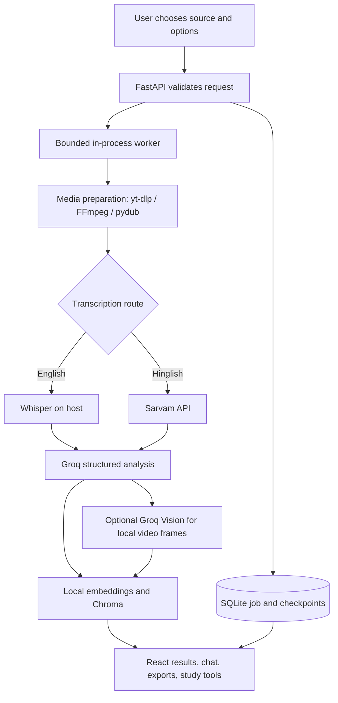

# FrameSutra project report

## Abstract

FrameSutra is a local-first video and audio analysis workspace, built with effort by Akarsh Mishra. It combines media preparation, speech recognition, structured language-model analysis, optional visual descriptions, vector retrieval, and an interactive review interface. The React client uses a FastAPI service to create and monitor jobs; SQLite stores job-related records, while Chroma stores local vector indexes.

## Problem statement

Long recordings take time to review and are difficult to search by topic. A useful review tool should provide a transcript, surface decisions and action items, and let a user ask targeted questions with supporting transcript evidence. It should also make the processing steps and data locations visible enough for a local user to operate the system responsibly.

## Objectives

1. Accept a public YouTube URL or a local audio/video file.
2. Transcribe English locally and support Hinglish transcription/translation through a configured provider.
3. Produce a structured title, summary, actions, decisions, and open questions.
4. Support transcript-grounded retrieval and chat with timestamped excerpts.
5. Offer optional sampled visual notes for local video uploads.
6. Keep job history, bookmarks, chats, study sets, and vector indexes in local project storage.
7. Expose job progress, retry/cancel behavior, exports, retention cleanup, and operating metrics.

## Scope

### Included

- React/Vite user interface and FastAPI job API.
- Single-process, bounded, in-process worker pool.
- SQLite persistence and checkpoint-based retry.
- YouTube audio acquisition and local media upload.
- Whisper and Sarvam language paths.
- Groq text generation and optional Groq vision analysis.
- Sentence-transformer embeddings and Chroma retrieval.
- Library, chat, bookmarks, chapter edits, study tools, PDF/Markdown/JSON/transcript exports, cleanup, and metrics.
- Legacy Streamlit UI as an alternate interface.

### Not included

- Multi-user authentication, tenant isolation, public-service abuse prevention, or a production-grade distributed queue.
- Word-level alignment, guaranteed speaker diarization, or guaranteed exact timecodes for Hinglish.
- A promise that all provider features are free, offline, or available at all times.
- A legal entity, contact address, software license, or governing jurisdiction. The project gives a builder credit but has no support channel.

## High-level design

## Implementation overview

| Layer | Implementation | Main files |
|---|---|---|
| User interface | React components, browser state, Vite development server | `frontend/src/App.jsx`, `styles.css`, `overrides.css` |
| HTTP API | FastAPI forms, JSON routes, file responses, polling | `api.py` |
| Job persistence | SQLite jobs, checkpoints, bookmarks, chat, study records, rate-limit events | `core/job_store.py` |
| Media | yt-dlp, FFmpeg, pydub chunking | `utils/audio_processor.py` |
| Speech | Local Whisper or Sarvam endpoint | `core/transcriber.py` |
| Structured analysis | Groq model, prompt chains, transcript handling | `core/analyzer.py`, `core/llm_provider.py` |
| Visual analysis | FFmpeg frame sampling, local deduplication, provider descriptions | `core/visual_analyzer.py` |
| Retrieval | Sentence-transformer embedding model and Chroma collections | `core/vector_store.py`, `core/rag_engine.py` |
| Operations | Metrics, retention cleanup, cache clearing, exports | `api.py`, `core/observability.py` |

## User workflow

1. Select a YouTube link, local file, or up-to-three-source batch.
2. Choose English or Hinglish and optionally enable visual sampling for a local video.
3. Accept the displayed agreement and start processing.
4. Monitor the persisted stage state and retry/cancel when available.
5. Review structured notes, transcript, visual timeline, chapters, study tools, and grounded chat.
6. Save/export useful outputs or delete the analysis when no longer needed.

## Data and privacy model

Processing is local-first but provider-connected. Local English Whisper, embeddings, retrieval, and the database run on the host. Hinglish audio can be sent to Sarvam. Groq may receive transcript excerpts, prompts, or optional sampled frames. Job and user data is not stored in an account service; it is stored in local files and SQLite. The API derives local ownership from request IP and is not authenticated.

See [Privacy and terms](PRIVACY_AND_TERMS.md) for data categories, retention defaults, and user responsibilities.

## Configured limits

Current defaults include one worker, three outstanding jobs, batches of up to three, 512 MB uploads, six-hour media, five job submissions per hour, fifteen chat/study requests per minute, 30-day unsaved-job expiry, and seven-day media cleanup. Operators can change these in `.env`.

## Evaluation and verification plan

This report describes implemented behavior and an evaluation plan; it does not claim a benchmark result. A deployment should be evaluated with:

| Check | Evidence to capture |
|---|---|
| Installation | Python dependency installation, Node dependency installation, FFmpeg/ffprobe availability |
| API startup | `/api/health`, `/docs`, and startup logs |
| Short English input | Transcript, timestamp quality, generated notes, and chat citation review |
| Hinglish input | Sarvam request success, translated transcript quality, provider disclosure |
| Local visual input | Extracted frame count, model descriptions, and expected provider transfer |
| Long input | Stage timing, memory/disk use, cancellation behavior, and checkpoint retry |
| Persistence | Restart API, inspect interrupted state, retry, delete job, confirm library state |
| Limits | Verify upload, duration, batch, rate, and queue rejection behavior |
| Cleanup | Confirm configured expiry removes expected records/media without deleting saved work |

The frontend `npm run build` command verifies bundle compilation only. It is not an end-to-end quality, security, or model-accuracy assessment.

## Risks and limitations

- Provider quotas, model availability, YouTube download behavior, and inference quality are external dependencies.
- Native Whisper and embeddings can consume substantial CPU, memory, storage, and first-run download bandwidth.
- SQLite/WAL and the local Chroma directory need coordinated backup; restoring only one may make analyses incomplete.
- Checkpoint resume can fail when referenced media expires or a provider/model configuration changes.
- The in-process queue and IP-derived ownership are suitable for local use only.
- Generated information can omit nuance, misrecognize speech, hallucinate, or cite approximate positions.

## Suggested future work

1. Add authenticated users and explicit per-user access checks before any network-facing release.
2. Add a durable external queue and worker supervision for long-running production jobs.
3. Add media preview/player synchronization and richer citation seeking.
4. Add stronger transcription-quality review, language detection, and optional diarization.
5. Add integration tests with stubbed providers and sanitized fixtures.
6. Add a supported production static-host/reverse-proxy configuration and deployment pipeline.
7. Publish maintainer/contact details, a software license, and reviewed legal terms if the project is shared publicly.

## Conclusion

FrameSutra provides an end-to-end local workspace for making long videos easier to review. Its value comes from combining structured notes with transcript retrieval and visible job progress. Its responsible use depends on understanding provider data transfers, verifying generated claims, protecting local storage, and keeping the service private until authentication and production operations are added.
