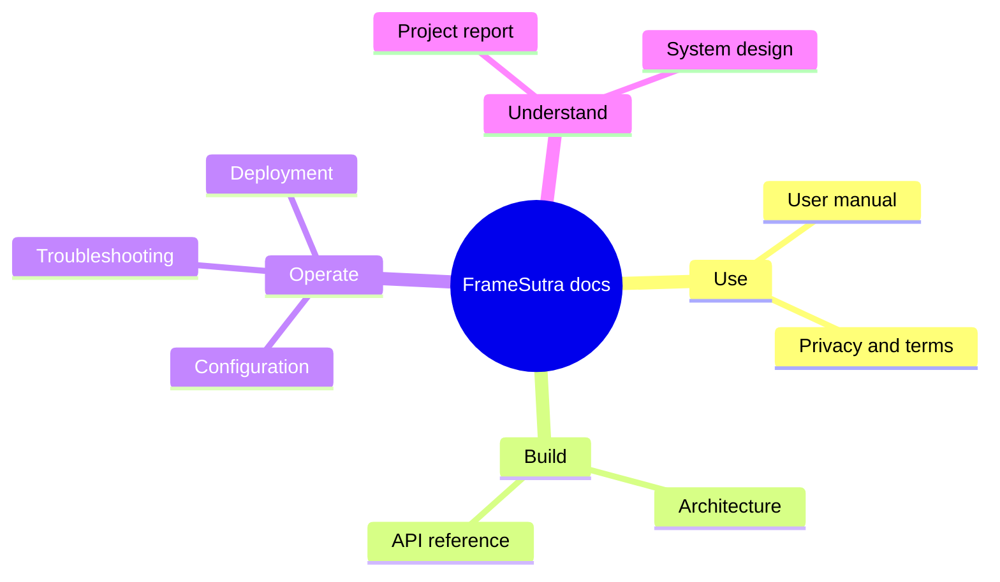

# FrameSutra documentation

Start with the page that matches what you need:

| I want to… | Open |
|---|---|
| Install and launch FrameSutra | [Quick start in the root README](../README.md#-quick-start) |
| Learn the interface | [User manual](USER_MANUAL.md) |
| Review the interface map and design details | [Product design](PRODUCT_DESIGN.md) |
| Explore the pipeline visually | [Interactive pipeline explorer](visuals/pipeline-explorer.html) |
| Understand the pipeline and code | [Architecture guide](ARCHITECTURE.md) |
| Call the backend directly | [API reference](API_REFERENCE.md) |
| Configure, maintain, and troubleshoot | [Operations guide](OPERATIONS.md) |
| Understand privacy and terms | [Privacy and terms](PRIVACY_AND_TERMS.md) |
| Read a project-level summary | [Project report](PROJECT_REPORT.md) |
| Deploy on a controlled host | [Deployment guide](../FrameSutra_DEPLOYMENT.md) |
| Review implementation limits | [System design](../SYSTEM_DESIGN.md) |

## At a glance

<strong>Documentation conventions</strong>

- Values marked **default** come from the current `.env.example` and source code; local `.env` overrides may differ.
- “Local” means the machine or container running the backend. It does not mean browser-only or offline processing.
- The primary interface is React + FastAPI. `app.py` remains as a legacy Streamlit option.
- API routes and configuration can change; `/docs` on a running API exposes its live OpenAPI schema.
- Project credit: built with effort by Akarsh Mishra. No support contact, legal entity, governing jurisdiction, or license has been supplied.

