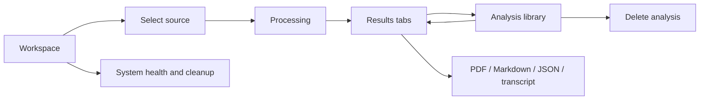

# FrameSutra user manual

This guide covers the React web interface. Start the FastAPI service and Vite frontend as described in the [quick start](../README.md#quick-start). Keep the API terminal running while you work.

Use the **Dark / Light** control in the header to switch the whole interface theme. Your choice is saved in this browser and applies across the workspace, results, library, system screen, dialogs, and not-found page. On the legacy Streamlit screen, use its Theme selector in the top navigation.

## 1. Start a workspace

1. Open the local Vite URL, usually `http://localhost:5173`.
2. Choose one source mode:
   - **YouTube link:** paste a public YouTube URL. The backend validates supported YouTube domains and asks `yt-dlp` to prepare audio.
   - **Upload a file:** select a local audio or video file. The visible picker supports common media formats; actual decoding depends on FFmpeg and server support.
   - **Batch:** paste one or more YouTube URLs and/or add local files. A batch can contain at most three sources.
3. Choose **English** or **Hinglish**. English uses Whisper on the host; Hinglish uses the configured Sarvam endpoint.
4. For a local video, optionally select **Analyze video frames**. This extracts sampled frames and uses the configured vision model to describe them.
5. Review and accept the User Agreement and Privacy Policy checkbox.
6. Select **Analyze video** or **Queue batch**.

### Input rules and limits

The defaults are 512 MB per uploaded file, six hours of media, three outstanding jobs, five submissions per hour, and one submission per 20 seconds. The API may reject an input earlier if a provider key is missing, the queue is full, the media is unsupported, or the configured limits are lower. Values are configurable in `.env`; see [Operations](OPERATIONS.md#configuration-reference).

## 2. Follow processing

The progress view lists these stages:

| Stage | What happens |
|---|---|
| Prepare audio | Validate duration, fetch YouTube audio or use an upload, convert, and create audio segments |
| Transcribe speech | Use Whisper or Sarvam; completed transcripts are checkpointed |
| Understand video | Generate a title and structured analysis with the configured language model |
| Summarize key points | Produce a readable summary |
| Extract insights | Identify action items, decisions, and open questions |
| Analyze visuals | Describe sampled frames when enabled; otherwise this stage is skipped |
| Prepare AI chat | Build or reuse the local vector index for transcript and visual evidence |

You can switch among the items in an active batch to view each job. **Cancel job** requests cooperative cancellation. An active model or media request may need to finish before cancellation takes effect.

If a job fails or the API restarts, the library may offer **Retry from checkpoint**. Retry creates a new job and can reuse saved stages where their files remain available. An interrupted job is not guaranteed to resume every external request from the exact point it stopped.

## 3. Read results

The completed analysis has several tabs:

- **Overview:** title, summary, decisions, actions, open questions, and bookmarks.
- **Transcript:** search within transcript segments, play available generated audio chunks, download the transcript, and use timestamp controls to jump in the source when a playable source is available.
- **Visuals:** optional sampled-frame descriptions for supported local videos.
- **Chapters:** generated ten-minute topic groupings. Edit a title and leave the field or press Enter to save it.
- **Study:** generate flashcards, key terms, or a new multiple-choice quiz. Flashcards and terms are saved with the analysis; quiz questions and answers remain in browser memory for the current session.
- **Ask video:** ask questions based on retrieved transcript and available visual evidence. Citations show excerpts and approximate source timestamps.

English timestamps come from Whisper speech segments when available. Hinglish and some older analyses use approximate ten-minute chunk markers. Timestamps are not word-level alignment and may not identify the exact spoken word.

### Bookmarks

Use a transcript segment’s bookmark icon to open the bookmark editor. Enter a timestamp in `HH:MM:SS` form, optionally add a note, then choose **Save**. Use the bookmark row controls to jump to a saved moment or delete it. Bookmarks are stored with the analysis in SQLite.

## 4. Use the Analysis Library

Open **Analysis library** from the navigation. Search by title or source, filter to saved analyses, and use the row controls to:

- Open an analysis and its saved chat history.
- Save or unsave an analysis so it is retained beyond normal automatic expiry.
- Retry an eligible failed/interrupted job from checkpoints.
- Delete an analysis and its associated local files/index where available. Deletion cannot be undone.

Unsaved records normally expire after 30 days. Saved records are retained until manually deleted. Media files have a default seven-day cleanup age. Operator configuration may change these periods.

## 5. Export and study

Available exports include:

- Transcript as a text file.
- Structured report as Markdown or JSON.
- Colorful PDF notes, generated by the API. PDF generation may request up to eight review question/answer pairs from the configured model and can fail if provider access is unavailable.

Flashcards and terms are generated from transcript excerpts and stored with the analysis. Quizzes generate ten questions and are not stored on the server; recent quiz questions are sent with a subsequent quiz request only to reduce repeats in the current UI session.

## 6. System page

Open **System** to view queue counts, completed/failed jobs, local disk metrics, provider counters, and retention settings.

- **Run cleanup now** applies configured job/media/cache age cleanup.
- **Clear reusable caches** removes selected transcript, analysis, frame, and YouTube audio cache files. It keeps saved analysis results; use library deletion for those.

Metrics are process-local and some counters reset when the API restarts. Keep the API bound to localhost or a trusted private interface. The app is not protected by user accounts or login.

## 7. Leave the workspace and delete your data

Use **New analysis** or **Workspace** to return to the start. Resetting the visible workspace clears browser-held active job IDs; it does not delete the saved analysis. Delete jobs from the library to remove individual records.

For a full local reset, stop the API and frontend, back up anything you need, then remove `uploads/`, generated files under `downloads/`, `vector_db/`, `.cache/`, and `videolens.sqlite3` plus its SQLite `-wal`/`-shm` files. Restarting recreates the required folders and database schema. See [backup and reset](OPERATIONS.md#backup-and-full-reset).

## Quick navigation map

